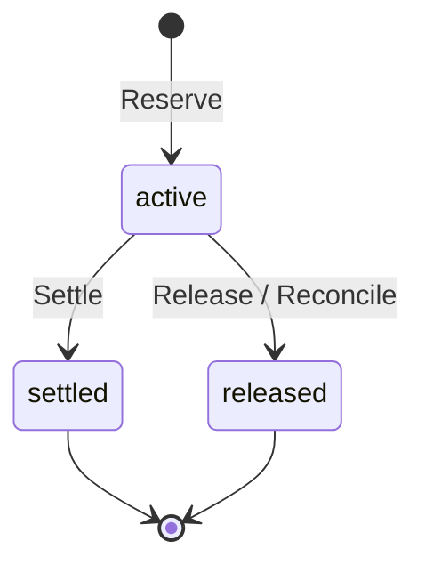

# AgentGate

A custody-grade gateway for AI agents: every model call and every payment is authorized, metered, limited and auditable.

## Status

Early work. Foundations plus the Postgres ledger. The gateway and policy layers land in later pull requests.

## Build and test

Requires Go and a reachable Postgres (17 recommended).

```bash
go build -o bin/agentgate ./cmd/agentgate
bin/agentgate version

createdb agentgate_test
export DATABASE_URL='postgres:///agentgate_test?host=/tmp'
gofmt -l . && go vet ./... && AG_REQUIRE_DB=1 go test -race -count=1 ./...
```

Without `DATABASE_URL`, database tests skip; with `AG_REQUIRE_DB=1` they fail instead. `agentgate migrate` applies the SQL files in `migrations/`.

Copy `.env.example` to `.env` for local secrets (gitignored) and `configs/agentgate.example.json` for config.

## Ledger

Money is `int64` Nanos (1e-9 USD). A request first **reserves** (holds) its worst-case cost with one conditional `UPDATE`, then **settles** the real cost or **releases** the hold. Retries with the same key replay the first result; a crashed process's hold is closed by `Reconcile` after it expires; an overage is charged only up to the free balance and the rest is flagged. `Audit` recomputes the invariants from the append-only `ledger_entries`.



Invariants I1-I7 and their tests are in [docs/learn/ledger.md](docs/learn/ledger.md). Single gateway process; the ledger itself is safe with several.

## Learn

- [Foundations](docs/learn/foundations.md)
- [Ledger](docs/learn/ledger.md)

## License

MIT
