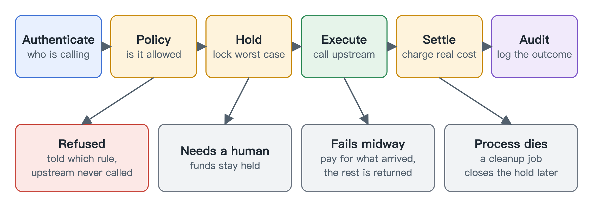

# AgentGate

A gateway between AI agents and everything that costs money. Every model call, tool call and payment is authorized, metered, limited and logged.

An agent that can spend money can also be hijacked by text in a tool result, so a bare API key with a budget is not enough. AgentGate keeps the keys, gives each agent a scoped identity, and checks every spend against a ledger and a policy before it happens.

Two rules carry the design:

- **Reserve before you spend.** The worst-case cost is held first, then settled to the real cost or released.
- **Screen before you sign.** A payment refused by policy never reaches the wallet's key.

## How it works



It is one Go process and one Postgres database. Operators use a CLI that writes to the database, so an agent has no HTTP route to approve its own requests.

Read more about each part. Each page takes a minute or two:

| Area | What it does |
|---|---|
| [Gateway](docs/gateway.md) | Sits between agents and model providers |
| [Ledger](docs/ledger.md) | Holds the money first, then charges the real cost |
| [Policy](docs/policy.md) | Sets what each agent may do and spend |
| [Tools](docs/tools.md) | Controls tool access and screens what comes back |
| [Payments](docs/payments.md) | Pays for tools in USDC, trusting the chain over the tool |
| [Runs](docs/runs.md) | Groups one job's steps so you can read or stop them together |
| [Python SDK](docs/sdk.md) | A small client for scripts and agents |
| [Testing](docs/testing.md) | How it's tested without spending money |

## Try it

You need Go and a running Postgres. This demo uses a fake model provider and a throwaway database, so it needs no keys and no network.

```bash
demo/phase1.sh
```

## Status

| Verified | How |
|---|---|
| Ledger, gateway, policy, MCP gateway, payments | Tests in CI, with no secrets |
| Payments on a local chain | Local anvil node with a mock USDC, in CI |
| OpenRouter | One small live run of 8 requests |

**Not done:** Base Sepolia payments and real-traffic dogfooding. This is testnet-only software for a single gateway process. See [Limits](docs/limits.md).

## License

MIT
