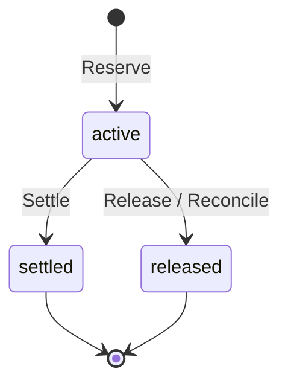
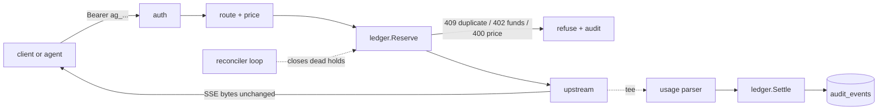

# AgentGate

A custody-grade gateway for AI agents: every model call and every payment is authorized, metered, limited and auditable.

## Status

Early work. Foundations, the Postgres ledger and the gateway (OpenAI-compatible and native Anthropic endpoints, streaming, audit, report). Policy and the later layers land in further pull requests.

## Build and test

Requires Go and a reachable Postgres (17 recommended).

```bash
go build -o bin/agentgate ./cmd/agentgate
bin/agentgate version

createdb agentgate_test
export DATABASE_URL='postgres:///agentgate_test?host=/tmp'
gofmt -l . && go vet ./... && AG_REQUIRE_DB=1 go test -race -count=1 ./...
```

Without `DATABASE_URL`, database tests skip; with `AG_REQUIRE_DB=1` they fail instead. `agentgate migrate` applies the SQL files in `migrations/`.

Copy `.env.example` to `.env` for local secrets (gitignored) and `configs/agentgate.example.json` for config.

## Ledger

Money is `int64` Nanos (1e-9 USD). A request first **reserves** (holds) its worst-case cost with one conditional `UPDATE`, then **settles** the real cost or **releases** the hold. Retries with the same key replay the first result; a crashed process's hold is closed by `Reconcile` after it expires; an overage is charged only up to the free balance and the rest is flagged. `Audit` recomputes the invariants from the append-only `ledger_entries`.



Invariants I1-I7 and their tests are in [docs/learn/ledger.md](docs/learn/ledger.md). Single gateway process; the ledger itself is safe with several.

## Gateway

Two endpoints, one flow. `POST /v1/chat/completions` (OpenAI format) and `POST /v1/messages` (native Anthropic, what Claude Code speaks; `Authorization: Bearer` and `x-api-key` both work). A request is authenticated to an account, routed by model prefix to a provider, priced from the price table, and **reserved** against the account before any upstream call. The response streams back byte for byte while a parser reads usage from the same bytes; then the real cost is **settled** and one audit row is written.



- **Providers.** `openai-compatible` (OpenAI, OpenRouter) forwards the path as is; `anthropic` forwards Messages natively and also translates chat completions (tool calls and SSE included). Routes map a model prefix to a provider and an upstream model name: [configs/providers.example.json](configs/providers.example.json). Anthropic body fields and `anthropic-version` / `anthropic-beta` headers pass through unchanged, so prompt caching and thinking keep working.
- **Cost.** In order: the provider's reported `cost`, the price table applied to reported tokens (input, output, cache read, cache write priced separately), a token estimate flagged `cost_source=estimated`. Prices come from `agentgate prices sync` (OpenRouter's free `/models`) into `configs/prices.json`; [an example](configs/prices.example.json) shows the shape.
- **Failures.** A stream that dies, ends without its terminal event (`[DONE]` / `message_stop`), carries an in-band error, a client that disconnects, a 429 or a 500 never leave a hold active: usage received so far is charged, the rest released, and the audit status says what happened.
- **Report.** `agentgate report --since 24h --by model` shows spend, tokens, cache hit rate, estimated cache savings and the split by cost source.
- **Single process.** One gateway process is assumed (the ledger itself is safe with several).

```bash
agentgate account create --name me                         # prints the account id
agentgate account deposit --account ID --amount 5
agentgate key create --account ID                          # prints the secret once
AG_PROVIDERS=configs/providers.json AG_PRICES=configs/prices.json OPENROUTER_API_KEY=... agentgate serve
agentgate report --since 7d --by model
agentgate reconcile                                        # one-shot; `serve` also runs it every 30s
```

Offline demo (fake upstream, throwaway database, no network): `demo/phase1.sh`.

### Live smoke

On 2026-11-03, 8 requests went through OpenRouter on `anthropic/claude-haiku-5.5`, on both endpoints, stream and non-stream. A cache write (3392 tokens) followed by a cache read (3392 tokens) was parsed correctly, and the ledger charge matched OpenRouter's `/generation` `total_cost` on the 2 generations checked. This was a single small run, not dogfooding.

### Latency overhead

Measured offline: `go run ./bench` starts a fake upstream with a fixed 20 ms delay before the first byte and 2 ms between events, plus an in-process gateway on a throwaway Postgres database, and sends the same streaming request directly and through the gateway (Apple M3 Pro, loopback, local Postgres 17). These are **overhead numbers against a fake, not real-provider latency**; real-traffic numbers come from dogfooding.

| concurrency | path | requests | TTFB p50 | TTFB p99 | total p50 | total p99 |
|---|---|---|---|---|---|---|
| 1 | direct to fake | 300 | 22.61ms | 23.75ms | 35.41ms | 36.78ms |
| 1 | via gateway | 300 | 24.48ms | 26.37ms | 39.64ms | 42.16ms |
| 50 | direct to fake | 3000 | 22.3ms | 27.36ms | 33.74ms | 37.12ms |
| 50 | via gateway | 3000 | 20.95ms | 67.78ms | 32ms | 80.76ms |

At concurrency 1 the gateway adds about 2 ms (first byte) to 4 ms (total) at p50 and 3 to 5 ms at p99 (auth, claim, reserve, attach, settle, audit: about six short Postgres round trips). At 50 the p99 grows by roughly 40 ms from database commit contention; the p50 comparison there is inside timer noise (the direct path's 20 ms timer sleeps longer than 20 ms on macOS). TTFB is the first body byte, total is the end of the stream.

## Security and threat model

The gateway's job is to keep a provider key and an account's money out of reach of the thing calling it: provider keys live only in the gateway's environment and are never logged, put in a span, or relayed (the client never sees upstream headers: only an allowlist is copied back); client credentials are 256-bit random secrets stored only as SHA-256; a request can spend only what its account holds, because the budget check is one atomic `UPDATE` in Postgres, not application code; prompts and responses are not stored unless an operator turns that on, and then bearer tokens and `sk-` patterns are redacted. It does not defend against a compromised gateway host (which holds the provider key and the database), a malicious operator, or secrets that appear in prompts in forms the redactor does not recognise (redaction is best effort, which is why storage is off by default). Single process, no TLS termination, no rate limiting yet: put it behind a reverse proxy on a trusted network. Per-agent policy and kill switches are the next layer.

## Learn

- [Foundations](docs/learn/foundations.md)
- [Ledger](docs/learn/ledger.md)
- [Gateway](docs/learn/gateway.md)

## License

MIT
