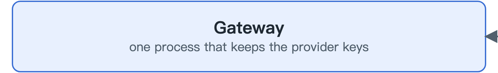
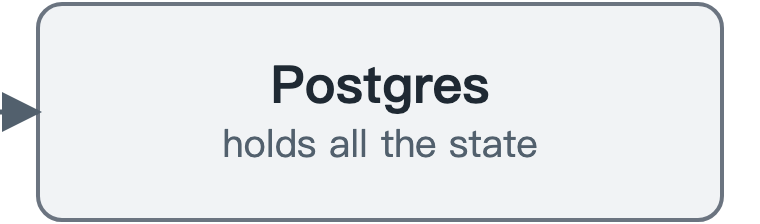
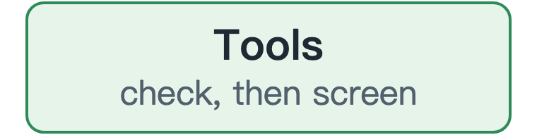
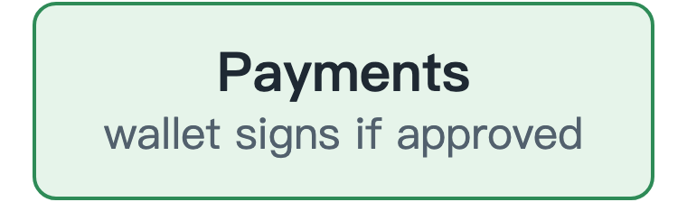
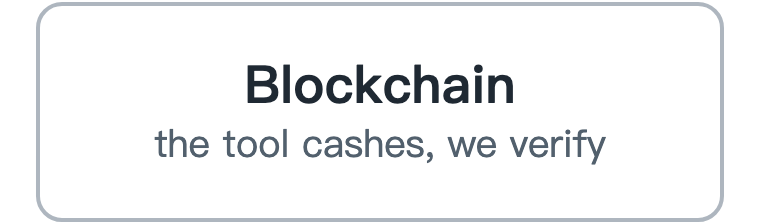

# AgentGate

English | [中文](README.zh-CN.md)

A gateway between AI agents and everything that costs money. Every model call, tool call and payment is authorized, metered, limited and logged.

An agent that can spend money can also be hijacked by text in a tool result, so a bare API key with a budget is not enough. AgentGate keeps the keys, gives each agent a scoped identity, and checks every spend against a ledger and a policy before it happens.

Two rules carry the design:

- **Reserve before you spend.** The worst-case cost is held first, then settled to the real cost or released.
- **Screen before you sign.** A payment refused by policy never reaches the wallet's key.

## Architecture

<p align="center">
<a href="docs/sdk.md"></a><a href="docs/policy.md"></a><br>
<br>
<a href="docs/gateway.md"></a><a href="docs/ledger.md"></a><br>
<br>
<a href="docs/policy.md"></a><a href="docs/ledger.md"></a><a href="docs/runs.md"></a><br>
<br>
<a href="docs/gateway.md"></a><a href="docs/tools.md"></a><a href="docs/payments.md"></a><br>
<br>
<a href="docs/gateway.md"></a><a href="docs/tools.md"></a><a href="docs/payments.md"></a>
</p>

Click a box to open its page.

## How it works

<p align="center"></p>

It is one Go process and one Postgres database. Operators use a CLI, or a local console, that writes to the database directly, so the gateway has no HTTP route an agent could use to approve its own requests.

Read more about each part. Each page takes a minute or two:

| Area | What it does |
|---|---|
| [Gateway](docs/gateway.md) | Sits between agents and model providers |
| [Ledger](docs/ledger.md) | Holds the money first, then charges the real cost |
| [Policy](docs/policy.md) | Sets what each agent may do and spend |
| [Tools](docs/tools.md) | Controls tool access and screens what comes back |
| [Payments](docs/payments.md) | Pays for tools in USDC, trusting the chain over the tool |
| [Runs](docs/runs.md) | Groups one job's steps so you can read or stop them together |
| [Console](docs/console.md) | A local page to watch agents, change their limits and run tasks |
| [Python SDK](docs/sdk.md) | A small client for scripts and agents |
| [Testing](docs/testing.md) | How it's tested without spending money |

## Try it

You need Go and a running Postgres. This demo uses a fake model provider and a throwaway database, so it needs no keys and no network.

```bash
demo/phase1.sh
```

To keep the gateway and the console running on your own machine, fill in `.env` from `.env.example` and use one script to start, stop or restart them:

```bash
scripts/agentgate-local up
```

## Status

| Verified | How |
|---|---|
| Ledger, gateway, policy, MCP gateway, payments | Tests in CI, with no secrets |
| Payments on a local chain | Local anvil node with a mock USDC, in CI |
| Payments on Base Sepolia | One live testnet settlement, below |
| OpenRouter | Early live testing, with more to come |
| Real traffic | The author's own Claude Code and two research agents, through a gateway on a GCP VM since 2026-11-08 |

**Dogfooding has started.** Over 7–8 November 2026: 223 model calls, 65 paid tool calls settled on Base Sepolia, $1.12 spent in all, 13 requests refused by policy and 8 tool outputs blocked by screening, across 6 agents. This is still testnet-only software for a single gateway process. See [Limits](docs/limits.md).

### Testnet settlement

This is **testnet** money with no real value. Nothing here is mainnet or production settlement.

On 2026-11-06 the gateway paid for one tool call on Base Sepolia (chain id 84532): [settlement transaction](https://sepolia.basescan.org/tx/0x07682129c2aaa44875659058cd142457d9b065f411a39783c08ea04cacc96141). The tool charged $0.01, policy approved it, the wallet signed, and the tool cashed the signature on chain. To repeat it, see the header of `demo/phase15.sh`.

| Role | Address |
|---|---|
| USDC (Circle test token) | [`0x036C…CF7e`](https://sepolia.basescan.org/address/0x036CbD53842c5426634e7929541eC2318f3dCF7e) |
| Payer wallet | [`0x9754…01E2`](https://sepolia.basescan.org/address/0x9754cA4033df6680B32a7f34a888Bec3E31c01E2) |
| Payee | [`0x7a88…75f7`](https://sepolia.basescan.org/address/0x7a889Db6Ebf3A876E6E2035017A2624814F475f7) |
| Gas payer | [`0x85f5…f659`](https://sepolia.basescan.org/address/0x85f51b4dE84e47aA439b5C0aE79BDe437571f659) |

We deployed no contract of our own. Settlement uses the transfer-by-signature function that USDC already has.

## License

MIT
