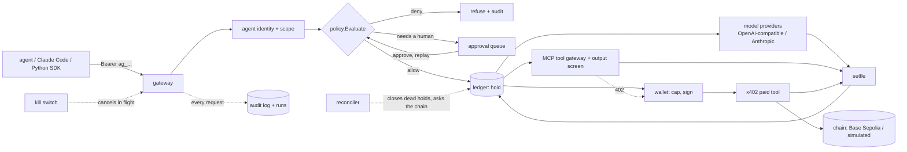
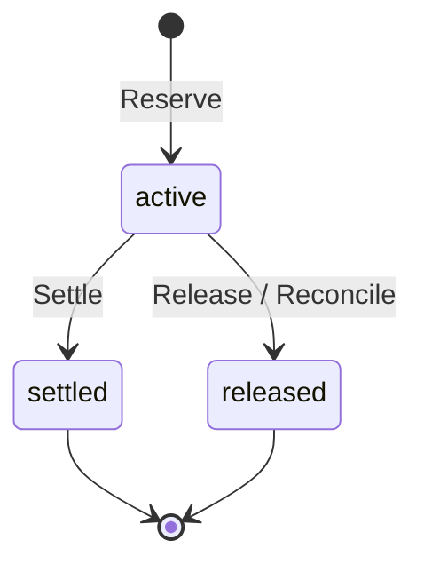
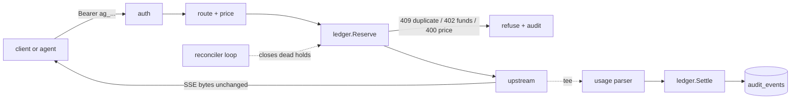
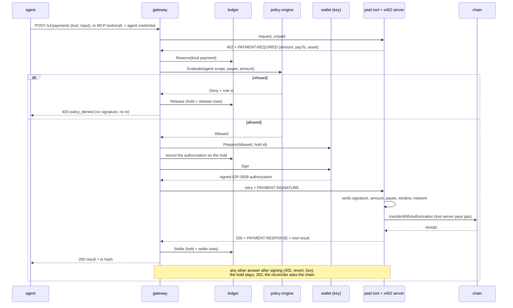
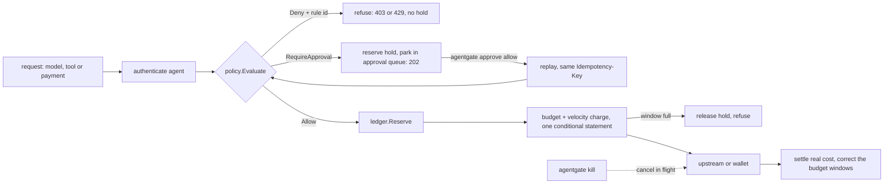
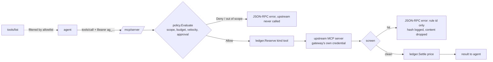

# AgentGate

A custody-grade gateway for AI agents: every model call, tool call and payment is authorized, metered, limited and auditable.

## Thesis

An agent that can spend money is closer to a bank client than to an API user. A bare key with a budget is not enough: the thing holding it can be hijacked by text in a tool result. So AgentGate treats an agent as a **scoped identity** in front of a **ledger**, and puts one decision point, `policy.Evaluate`, in front of everything that costs money: model calls, MCP tool calls and on-chain payments. The two rules that carry the design:

- **Reserve before you spend.** Every cost is held in a double-entry ledger first (one conditional `UPDATE`, so parallel requests cannot overspend), then settled to the real amount or released. Retries, crashes and races leave the books balanced, and a function recomputes that from the append-only entries.
- **Screen before you sign.** The wallet's signing path takes a value only the policy package can construct, so a refused payment never reaches the key, and the wallet adds its own cap as an independent second check.

## Architecture



## Phase status

| Phase | What | State |
|---|---|---|
| 1 | Credits ledger, OpenAI-compatible and native Anthropic gateway, streaming, audit, report | built; offline tests; one small live smoke |
| 1.5 | x402 payments with screen-before-sign, on a simulated chain | built; offline tests |
| 2 | Policy engine, approval queue, kill switch, MCP tool gateway, output screening, runs | built; offline tests |
| 3 | Python SDK, 45-scenario policy benchmark in CI, full wallet behind the policy engine, tool payments through MCP, side-by-side report, balance route | built; offline tests; the Base Sepolia run is written but **not run** |
| 4 | Not started | backlog |

## Measured numbers

Every number below says where it came from. Nothing here was measured on real traffic.

| What | Value | Source |
|---|---|---|
| Gateway overhead, concurrency 1 | about 2 ms first byte, 4 ms total (p50) | **offline**, fake upstream, `go run ./bench` ([details](#latency-overhead)) |
| Policy benchmark | 45 of 45 scripted scenarios as expected | **offline**, `go run ./benchmark`, checked in CI ([details](#benchmark)) |
| Output screen | 0 missed of 22 malicious, 0 false positives of 13 benign samples; 6 known evasions listed separately | **offline**, a corpus written together with the rules: not a security claim ([details](#screening-tool-output)) |
| Cost accuracy | ledger charge matched OpenRouter's `total_cost` on 2 of 2 generations checked | **live**, OpenRouter, 8 requests on 2026-11-03 ([details](#live-smoke)) |
| Payments on Base Sepolia | not run | **live**, pending |

### Dogfooding results

> **Placeholder, to be filled by a human with real data.** No dogfooding has been run, so there are no numbers here: no request counts, no spend, no cache hit rate, no latency from real traffic, no policy refusals. When data exists it goes in this section, labelled live.

## Build and test

Requires Go and a reachable Postgres (17 recommended).

```bash
go build -o bin/agentgate ./cmd/agentgate
bin/agentgate version

createdb agentgate_test
export DATABASE_URL='postgres:///agentgate_test?host=/tmp'
gofmt -l . && go vet ./... && AG_REQUIRE_DB=1 go test -race -count=1 ./...
```

Without `DATABASE_URL`, database tests skip; with `AG_REQUIRE_DB=1` they fail instead. `agentgate migrate` applies the SQL files in `migrations/`.

Copy `.env.example` to `.env` for local secrets (gitignored) and `configs/agentgate.example.json` for config.

## Ledger

Money is `int64` Nanos (1e-9 USD). A request first **reserves** (holds) its worst-case cost with one conditional `UPDATE`, then **settles** the real cost or **releases** the hold. Retries with the same key replay the first result; a crashed process's hold is closed by `Reconcile` after it expires; an overage is charged only up to the free balance and the rest is flagged. `Audit` recomputes the invariants from the append-only `ledger_entries`.



Invariants I1-I7 and their tests are in [docs/learn/ledger.md](docs/learn/ledger.md). Single gateway process; the ledger itself is safe with several.

## Gateway

Two endpoints, one flow. `POST /v1/chat/completions` (OpenAI format) and `POST /v1/messages` (native Anthropic, what Claude Code speaks; `Authorization: Bearer` and `x-api-key` both work). A request is authenticated to an account, routed by model prefix to a provider, priced from the price table, and **reserved** against the account before any upstream call. The response streams back byte for byte while a parser reads usage from the same bytes; then the real cost is **settled** and one audit row is written.



- **Providers.** `openai-compatible` (OpenAI, OpenRouter) forwards the path as is; `anthropic` forwards Messages natively and also translates chat completions (tool calls and SSE included). Routes map a model prefix to a provider and an upstream model name: [configs/providers.example.json](configs/providers.example.json). Anthropic body fields and `anthropic-version` / `anthropic-beta` headers pass through unchanged, so prompt caching and thinking keep working.
- **Cost.** In order: the provider's reported `cost`, the price table applied to reported tokens (input, output, cache read, cache write priced separately), a token estimate flagged `cost_source=estimated`. Prices come from `agentgate prices sync` (OpenRouter's free `/models`) into `configs/prices.json`; [an example](configs/prices.example.json) shows the shape.
- **Failures.** A stream that dies, ends without its terminal event (`[DONE]` / `message_stop`), carries an in-band error, a client that disconnects, a 429 or a 500 never leave a hold active: usage received so far is charged, the rest released, and the audit status says what happened.
- **Report.** `agentgate report --since 24h --by model` shows spend, tokens, cache hit rate, estimated cache savings and the split by cost source.
- **Single process.** One gateway process is assumed (the ledger itself is safe with several).

```bash
agentgate account create --name me                         # prints the account id
agentgate account deposit --account ID --amount 5
agentgate key create --account ID                          # prints the secret once (an agent with the default scope)
AG_PROVIDERS=configs/providers.json AG_PRICES=configs/prices.json OPENROUTER_API_KEY=... agentgate serve
agentgate report --since 7d --by model
agentgate reconcile                                        # one-shot; `serve` also runs it every 30s
```

Offline demo (fake upstream, throwaway database, no network): `demo/phase1.sh`.

### Live smoke

On 2026-11-03, 8 requests went through OpenRouter on `anthropic/claude-haiku-5.5`, on both endpoints, stream and non-stream. A cache write (3392 tokens) followed by a cache read (3392 tokens) was parsed correctly, and the ledger charge matched OpenRouter's `/generation` `total_cost` on the 2 generations checked. This was a single small run, not dogfooding.

### Latency overhead

Measured offline: `go run ./bench` starts a fake upstream with a fixed 20 ms delay before the first byte and 2 ms between events, plus an in-process gateway on a throwaway Postgres database, and sends the same streaming request directly and through the gateway (Apple M3 Pro, loopback, local Postgres 17). These are **overhead numbers against a fake, not real-provider latency**; real-traffic numbers come from dogfooding.

| concurrency | path | requests | TTFB p50 | TTFB p99 | total p50 | total p99 |
|---|---|---|---|---|---|---|
| 1 | direct to fake | 300 | 22.61ms | 23.75ms | 35.41ms | 36.78ms |
| 1 | via gateway | 300 | 24.48ms | 26.37ms | 39.64ms | 42.16ms |
| 50 | direct to fake | 3000 | 22.3ms | 27.36ms | 33.74ms | 37.12ms |
| 50 | via gateway | 3000 | 20.95ms | 67.78ms | 32ms | 80.76ms |

At concurrency 1 the gateway adds about 2 ms (first byte) to 4 ms (total) at p50 and 3 to 5 ms at p99 (auth, claim, reserve, attach, settle, audit: about six short Postgres round trips). At 50 the p99 grows by roughly 40 ms from database commit contention; the p50 comparison there is inside timer noise (the direct path's 20 ms timer sleeps longer than 20 ms on macOS). TTFB is the first body byte, total is the end of the stream.

## Payments

An agent can pay for a paid tool call, through `POST /v1/payments` or by calling an MCP tool that answers HTTP 402, through the public [x402](https://github.com/coinbase/x402) flow (v2, `exact` scheme, EIP-3009 `transferWithAuthorization`), hand-written here with go-ethereum and no x402 SDK. The rule that matters is **screen before sign**: the wallet's only signing path takes a `policy.Allowed`, a value only package `policy` can construct, so a refused payment never reaches the key and never reaches the chain (I10). The EIP-3009 nonce is derived from the ledger hold id, so a retried payment cannot settle twice on chain (I11).



Run it offline, with a simulated EVM chain inside the paid-tool process:

```bash
demo/phase15.sh     # POST /v1/payments: one payment settles, one is refused before signing
demo/phase3.sh      # MCP tool payments, approval path, side-by-side report reconciled with the chain
```

`phase15.sh` makes a $0.01 payment that settles and a $0.50 one that is over the agent's $0.30 budget and is refused before signing. `phase3.sh` has an agent call paid MCP tools: the tool answers 402, policy allows, the wallet signs, the same call is retried, and the agent sees one result (one run step, one audit row). Then an over-policy payment is refused before signing, an over-threshold one is queued, approved and paid once, and `agentgate report --by agent` prints model spend and tool payments side by side.

### Tool payments through MCP

An MCP `tools/call` whose upstream answers `402` with a `PAYMENT-REQUIRED` header (and which has no list price in config) takes the same path as `/v1/payments`: idempotency claim, approval queue, a hold of kind `payment`, `policy.Evaluate` on payee, amount and network, the wallet, then one retry of the same call with `PAYMENT-SIGNATURE`. The paid result is screened like any tool output. A refusal before signing is a JSON-RPC error; the settlement-pending answer is a JSON-RPC error with code `settlement_pending`.

### Side-by-side report

```bash
agentgate report --since 24h --by agent --payments payments.json
```

One row per agent: model requests and USD, priced tool calls, payment requests and USD, payments still pending, total. With `--payments` it also compares each payment hold with the chain through the authorization recorded on the hold: a settled hold whose authorization never executed (`ledger_without_transfer`), or an authorization that executed while the hold is released or open (`transfer_without_ledger`), is a finding and the command exits non-zero. Offline it reads the simulated chain; live it reads `AG_RPC_URL`. It starts from the ledger's holds, so a transfer made with the wallet key outside the gateway is not seen.

### Balance

`GET /v1/balance` (agent credential) returns the account's `balance`, `held`, `available`, the agent's `daily_spent` and, when it has a daily budget, `daily_budget` and `remaining_today`. It is read-only and shows nothing of any other agent.

What this is and is not:

- The offline run uses a mock token with Circle USDC's EIP-3009 interface, so it proves the protocol logic, not Base Sepolia behaviour.
- A run on Base Sepolia (`demo/phase15.sh --network base-sepolia`, needing an RPC URL, a gas-funded facilitator key and a USDC-funded wallet from the environment) is built but **separate and not part of the offline demo or CI**. The USDC address used there is Circle's [documented](https://developers.circle.com/stablecoins/usdc-contract-addresses) Base Sepolia one.
- The wallet refuses to start for any chain id except 84532 and the local simulated chain, enforces its own per-transaction cap ($1 by default, `max_tx_usd`; it cannot be switched off) after and independent of policy, and prints as its address only. `agentgate wallet new` writes a testnet key to a gitignored `0600` file and prints only the address.
- After signing, the chain is the source of truth, and the tool's word is not. The authorization is recorded on the ledger hold before it is signed. A tool that answers 402 or reports a revert after receiving the signature still holds a signed authorization and could submit it until `validBefore`, so no post-signature "no" releases the hold. Only a reported success settles; every other outcome (402, revert report, lost connection, 5xx, a ledger failure after the transfer) leaves the hold for the reconciler, which asks the token contract: used, so it settles the authorized amount; unused with the window still open, so it waits; unused with the window closed, so it releases. A failed tool call therefore returns money after about three minutes, not at once. A test has a tool report failure and then submit the authorization: the ledger charges once.
- Who may pay whom is part of the agent's scope: its tool and payee allowlists, its daily and per-task budgets, its velocity limit and approval threshold (see [Policy](#policy)). The payments config file lists tools, the network and the wallet cap (`demo/payments.example.json`).

## Policy

Custody for agents: an agent is not "an API key with a budget", it is a **scoped identity**. Each agent has one credential, one ledger account, and a scope that says what it may use and how fast it may spend. One pure function, `policy.Evaluate(Request, Snapshot) Decision`, sits in front of model calls, tool calls and payments and answers `Allow`, `Deny` or `RequireApproval` with a rule id. Every decision, allow included, is written to an append-only `policy_decisions` table.

| What a custodian does | What AgentGate does | Rule id |
|---|---|---|
| Opens an account for one named client | `agent create`: one agent, one credential (SHA-256 stored), one ledger account | |
| Writes down what the client may hold or touch | Scope allowlists: models, tools, payees (default deny; a trailing `*` is a prefix) | `scope_model`, `scope_tool`, `scope_payee` |
| Sets a daily limit | Daily budget per UTC day, one conditional `UPDATE`, so parallel requests cannot exceed it | `budget_daily` |
| Limits what a single job may cost | Per-task budget, keyed by the `X-AgentGate-Task` header | `budget_task` |
| Limits how fast money may leave | Velocity: spend in a sliding 60 s window, in Postgres | `velocity` |
| Asks a second person above a limit | Approval queue: over-threshold requests wait with their money held; `approve allow` releases them once | `approval_threshold` |
| Freezes an account in an emergency | Kill switch: next request refused, in-flight streams cancelled within a second, usage received is settled | `agent_killed` |
| Closes an account | `agent revoke`: permanent, refused at once | `agent_revoked` |
| Keeps a ledger of every decision | `policy_decisions` rows with the rule id, joined to `audit_events` by request id | |

The rule order is fixed, and the first rule that fires decides: kill/revoke, then scope, then budget, then velocity, then approval. A request that breaks two rules always reports the earlier one, so a dead credential learns nothing else about the policy, and a human is only asked about requests that are otherwise allowed.



```bash
agentgate agent create --account ID --name researcher --models 'claude-*' --tools echo \
    --payees 0x7099... --daily 5 --task 1 --velocity 0.5 --approval-over 0.25    # prints the secret once
agentgate agent list
agentgate approve list                      # requests waiting for a human
agentgate approve allow ID --by alice       # the agent replays the request once, same Idempotency-Key
agentgate approve deny ID                   # releases the hold
agentgate kill --agent researcher           # and --resume to undo; `agent revoke` is permanent
```

- **Budgets count spend, not guesses.** A request is counted at its worst-case estimate when it is admitted and corrected to the real cost when it settles or is released. The reconciler does the same for a hold whose process died, so a crash does not leak budget.
- **Which limits are hard.** The daily budget and velocity bind a hostile agent. The per-task budget does not: the caller chooses `X-AgentGate-Task`, so a new value per call starts a fresh window; it limits a cooperative client.
- **Approvals are exact.** An approval pins the request (kind, model or tool, payee, amount, network, task, body); replaying the same `Idempotency-Key` with anything different is refused (422), the replay runs once (a second is 409), and an unused approval expires (default 15 minutes) and releases its hold. An approval lifts the approval threshold only: a budget or scope that no longer fits still refuses it. The approver's name is recorded.
- **No self-approval.** There is no HTTP route that approves, changes an agent or kills one. The CLI needs direct database access, which an agent credential never has.
- **T2 API keys keep working.** A migration turns every existing key into an agent with the default scope (any model, any tool, no limits, no payees), so existing clients are unaffected and cannot pay until a payee is listed.
- **Single gateway process.** The kill switch registry and the velocity window are simple because there is one process; the CLI kills through the database and the gateway notices within 250 ms.

Offline demo (burn a budget, trip velocity, queue and approve a request, refuse an out-of-scope model, kill a stream mid-flight): `demo/phase2-policy.sh`. Study guide: [docs/learn/policy.md](docs/learn/policy.md).

## MCP gateway

Tool calls go through the same gate as model calls. `POST /mcp/{server}` is an MCP **Streamable HTTP** proxy to an upstream server named in [demo/mcp.example.json](demo/mcp.example.json); the client names a server, never a URL. The gateway authenticates the agent, decides, meters, screens what comes back, and writes an audit row, so a tool call is as controlled as a model call.



- **Protocol: 2026-07-28** (modelcontextprotocol.io, the current revision). It has no sessions and no `initialize` handshake: every POST carries its version and capabilities in `params._meta`, mirrored in `MCP-Protocol-Version`, `Mcp-Method` and `Mcp-Name`. The gateway is stateless to match: it checks that the headers agree with the body (a mismatch is `400` / `-32020`), answers an unsupported version with `-32022` and the supported list, answers `initialize` (the old handshake) with an error that names the supported version, answers GET and DELETE with `405`, and ignores `Mcp-Session-Id`. The gateway speaks MCP 2026-07-28 only, so an older client or server is refused. It has been checked once against `@modelcontextprotocol/server-everything` 2.1.0 (`tools/list` and `tools/call` echo through the gateway); everything else is tested against the in-repo fake. It does not speak earlier revisions; an upstream that only does will be refused by the gateway's own requests and the failure shows as `upstream_error`.
- **Responses** are JSON or SSE. SSE is screened event by event and forwarded as it arrives; the stream ends when the response ends.
- **Upstream credentials stay on the server.** A server entry names an environment variable (`auth_env`) whose value is the full header; the client's own `Authorization` is never forwarded and the upstream's never reaches a client or a log (I9).
- **`tools/list`** returns only the tools the agent's allowlist permits (names are `server/tool`, so `up/*` matches one server). **`tools/call`** is: policy, reserve (kind `tool`, price per call from config, default 0), forward, screen, settle, audit. A refused call is a JSON-RPC error with HTTP 200 (`40301` policy denied with `data.rule`, `40201` funds, `40202` approval needed with `data.approval_id`, `40302` screened, `40901` duplicate); only a bad credential (401) and a malformed request (400) are transport errors.
- **Free tools** (price 0, the default) still get a decision: the same engine answers with the limits removed, so scope and agent status apply, nothing is reserved or charged, and the decision is logged with amount 0. `Evaluate` keeps refusing amount 0 for models and payments.
- **Billing rule.** A priced call that returns a result is charged, including one the screen then blocks (the tool ran). A call that fails, is cancelled, or returns a JSON-RPC error is released.
- **Everything else** (resources, prompts, discover, ping) is forwarded and logged, not inspected, not screened and not metered.

### Screening tool output

Tool output is text someone else wrote, and an agent may read it as an instruction. `internal/screen` runs deterministic rules first: instruction-override phrases, role markers and chat templates, invisible or direction-changing Unicode, base64/hex/percent-encoded text that decodes to one of those, and URLs that would carry data out. An optional judge (`serve --screen-judge-model`, off by default; a fake in tests, the real one has not been run) asks a small model for a second opinion; when it is on and fails, the content is blocked, not passed. A hit returns an error and logs the rule id and a SHA-256 of the content in `screen_events`: never the content.

Measured on the committed corpus (`internal/screen/testdata`, 22 malicious and 13 benign samples): 0 missed, 0 false positives. **That number is not a security claim**: the rules and the corpus were written together, so it shows the rules do what they say, not how an adversary fares. What rule-based screening cannot do:

- It misses what it has no phrase for: a paraphrase, another language, split words, look-alike letters, ROT13, or a plain request that reads like ordinary prose. `testdata/evasions` holds six such samples, and a test pins that they pass, so the limit is in the repository rather than in a hope.
- It does not read images or audio, only text. It screens `tools/call` results, not `tools/list` descriptions (a poisoned tool description is not caught) and not resources or prompts.
- Some benign text will trip it (a document about prompt injection, an invisible character in scraped text).

So screening lowers the odds of the cheap attacks and gives an audit trail. The limits that hold against a hijacked agent are the ones that do not depend on reading text: tool scope, budgets, velocity, and approval.

## Runs

A **run** is one unit of agent work. Send `X-AgentGate-Run: <id>` (letters, digits, `. _ : -`, up to 64) or let the gateway create one; the id comes back in the response header and in every audit row. Model calls, tool calls and payments under one id are the run's **steps**, in order, each with kind, name, status, cost and times. A run is owned by the agent that first used its id.

```bash
agentgate run list                 # newest runs, each with its spend
agentgate run show RUN_ID          # steps in order, spend, status
agentgate run kill RUN_ID          # the run's next request is refused (run_killed), its in-flight calls are cancelled within a second
```

The spend of a run is summed from `ledger_entries` through the hold of each step, so it cannot disagree with `ledger.Audit`. Killing a run is the same mechanism as killing an agent (I12), keyed by run: the CLI writes the database, the gateway's kill watcher finds it and cancels. A killed tool call is released, a killed stream settles what arrived. A run that is refused still gets a step, with its refusal status. Single gateway process, as everywhere else.

Offline demo (list, call a free and a priced tool, refuse an out-of-scope one, block an injected result, show a run, kill it mid-call): `demo/phase2-mcp.sh --offline`. Without `--offline` it uses `npx @modelcontextprotocol/server-everything` as the upstream. Study guide: [docs/learn/mcp-runs.md](docs/learn/mcp-runs.md).

## SDK

A thin Python client, `sdk/python` (package `agentgate`, Python 3.11+, one dependency: `httpx`, about 250 lines). It is synchronous, has no retry layer, and sends what the gateway requires so an agent does not have to know it.

```python
from agentgate import Client, BudgetExceeded, ApprovalRequired, SettlementPending

with Client("http://127.0.0.1:8080", key) as c, c.run() as run_id:          # one run id for every call in the block
    c.chat("fake/chat", [{"role": "user", "content": "hi"}])                # OpenAI-compatible
    for chunk in c.chat_stream("fake/chat", messages): ...                  # SSE chunks, parsed
    c.tool_call("up", "echo", {"text": "hi"})                               # MCP tools/call (2026-07-28 fields and headers added for you)
    c.pay("echo", {"text": "hi"})                                           # x402 payment through the gateway
    c.balance()["remaining_today"]                                          # what this agent may still spend today
```

- **Errors come from the rule id, not the HTTP status.** `BudgetExceeded` (`budget_daily`, `budget_task`), `VelocityLimited`, `ScopeDenied` (`scope_model`, `scope_tool`, `scope_payee`), `Killed` (`agent_killed`, `agent_revoked`, `run_killed`), `Duplicate`, `ScreenedOutput` (a tool result the screen blocked). Every one carries `.rule`, `.status` and `.request_id`; anything else is `AgentGateError`.
- **A 202 is never success.** `ApprovalRequired(id)` means a human must approve (replay the same request with the same `idempotency_key` afterwards). `SettlementPending` means a payment may have settled and the gateway will resolve it from the chain: do not retry with a new key.
- **`balance()`** calls `GET /v1/balance`: balance, held, available and today's spend, with the remaining daily budget when there is one, so an agent can plan inside its budget instead of finding the limit by being refused.
- **Tests** (`pytest`, in CI) run the SDK against a real gateway built from the same commit, with fakes and a simulated chain: `cd sdk/python && AG_REQUIRE_DB=1 DATABASE_URL=... pytest`.
- **Demo agents** in [demo/agents](demo/agents) are scripts on the SDK, with no LLM: `runaway.py`, `paying.py`, `injected.py`.

The five-minute demo, offline (burn a budget, trip velocity, queue an over-limit payment and approve it, kill a stream mid-run, refuse an out-of-scope tool): `demo/demo.sh`. It needs Python 3.11+ with httpx (`AG_PYTHON` names the interpreter; `pip install ./sdk/python` provides httpx). Study guide: [docs/learn/sdk-benchmark.md](docs/learn/sdk-benchmark.md).

## Benchmark

`go run ./benchmark` boots the whole gateway in process on fakes (a fake model upstream, a fake MCP server, a simulated chain, a throwaway Postgres database) and plays every scenario in [benchmark/scenarios](benchmark/scenarios). A scenario is `{id, category, setup, steps, expected: allow|deny|approval, rule}`: the setup is the agent's scope, the steps are played in order, and `expected` and `rule` describe the last step. It passes only when both the verdict and the rule id match. The run exits non-zero on any mismatch and writes [benchmark/results.md](benchmark/results.md); CI regenerates this table and fails if it is stale.

<!-- benchmark:start -->
| category | scenarios | as expected |
|---|---|---|
| allow | 11 | 11 |
| injection | 6 | 6 |
| killed-agent | 4 | 4 |
| out-of-scope-model | 3 | 3 |
| out-of-scope-tool | 3 | 3 |
| over-budget | 4 | 4 |
| over-policy-payment | 4 | 4 |
| over-threshold-payment | 3 | 3 |
| revoked-credential | 4 | 4 |
| velocity | 3 | 3 |

| class | precision | recall |
|---|---|---|
| allow | 100.0% (11/11) | 100.0% (11/11) |
| deny | 100.0% (31/31) | 100.0% (31/31) |
| approval | 100.0% (3/3) | 100.0% (3/3) |

Plus 6 known screen evasions listed as expected misses, outside these counts. Full table: [benchmark/results.md](benchmark/results.md).
<!-- benchmark:end -->

**The 100% is for 45 scripted scenarios** written alongside the rules they exercise. It shows the rules do what they say; it is not a measure of how the gateway fares against an adversary who has not read them. The 6 known evasions above are real misses, kept visible on purpose.

- **Allow cases are there so refusing everything fails.** A gateway that denies all traffic scores 100% deny recall and 0% allow recall.
- **Injection rows are honest.** The screen's rules are scored on a corpus written together with them, so a clean score is not a security claim. The six samples in `internal/screen/testdata/evasions` are known misses; `results.md` lists them as expected misses, outside the counts, and the run fails if one starts being caught (so it moves into the scored set).
- **The task budget is not a hard limit.** The caller chooses `X-AgentGate-Task`; scenario `allow-new-task-new-window` shows a fresh value getting a fresh window. Only the daily budget and velocity bind a hostile agent.
- **Mutation check.** Disabling one rule (velocity) makes three scenarios fail and the run exit 1; this is how we know the benchmark can fail.

## Security and threat model

The gateway's job is to keep a provider key and an account's money out of reach of the thing calling it: provider keys live only in the gateway's environment and are never logged, put in a span, or relayed (the client never sees upstream headers: only an allowlist is copied back); client credentials are 256-bit random secrets stored only as SHA-256; a request can spend only what its account holds, because the budget check is one atomic `UPDATE` in Postgres, not application code; prompts and responses are not stored unless an operator turns that on, and then bearer tokens and `sk-` patterns are redacted. It does not defend against a compromised gateway host (which holds the provider key and the database), a malicious operator, or secrets that appear in prompts in forms the redactor does not recognise (redaction is best effort, which is why storage is off by default). Per-agent scopes, budgets, approvals and a kill switch limit what a credential can do (see [Policy](#policy)). Single process, no TLS termination, no request rate limiting: put it behind a reverse proxy on a trusted network.

## What I borrowed and what I did differently

Public gateway designs (LiteLLM, Portkey, Bifrost, OpenRouter) share a shape: an OpenAI-compatible front, virtual keys with budgets, routing by model name, spend logs, and guardrail hooks. I read their public documentation, not their code, and wrote everything here from scratch.

| Borrowed | Where it came from | What is different here |
|---|---|---|
| OpenAI-compatible endpoint, model-prefix routing, per-key budgets | the public gateways | The budget check is one conditional `UPDATE` in Postgres, enforced by `CHECK` constraints, not an application counter. |
| Spend logs | the public gateways | An append-only audit table plus a double-entry ledger that a function can re-audit (I1, I2). |
| Authorize, then capture or void | card networks | Every cost is a hold with a lease; a dead process's hold is found and closed by a reconciler (I6). |
| Idempotency keys | payment APIs | A key replay changes nothing and returns the first result; the same key with other parameters is an error (I4). |
| Generation lookup for real cost | OpenRouter | Used as the usage source when a process died before settling. |
| HTTP 402 payment flow, `exact` scheme | the x402 spec | Hand-written client and verifier (no SDK), the nonce derived from the hold id, and the wallet signs only behind a policy decision. |
| `transferWithAuthorization` | EIP-3009 | The chain, not the paid tool, decides whether money moved: the hold waits for the authorization window to close. |
| Guardrail hooks | the public gateways | Agent identity, not a key, is the unit: scope, approval queue and kill switch are part of the engine and its order is fixed. |
| MCP tool proxy | the MCP spec | Tool results are screened before the agent sees them; tool calls and payments are steps of the same run. |

Not here: provider fallback, load balancing, a dashboard, multi-tenant management, a plugin system.

## Limits

- **Single gateway process.** The kill-switch registry and the velocity window are in one process. The ledger itself is safe with several.
- **Testnet only.** The wallet refuses every chain but Base Sepolia (84532) and the local simulated one. No mainnet, ever, in this code.
- **Offline proof is not live proof.** The simulated chain uses a mock token with USDC's EIP-3009 interface. Base Sepolia behaviour (fees, RPC, real USDC) is untested until the live run.
- **Reorgs** after a receipt are not handled.
- **Screening is rule-based.** It lowers the odds of cheap attacks; budgets, scope and approval are what hold against a hijacked agent.
- **Chain reconciliation starts from holds.** A transfer made with the key outside the gateway is not seen.
- **No dogfooding data yet**, and no real-traffic latency.

## Learn

- [Foundations](docs/learn/foundations.md)
- [Ledger](docs/learn/ledger.md)
- [Gateway](docs/learn/gateway.md)
- [Payments](docs/learn/payments.md)
- [Policy](docs/learn/policy.md)
- [MCP gateway and runs](docs/learn/mcp-runs.md)
- [SDK, benchmark and demo](docs/learn/sdk-benchmark.md)

## License

MIT
