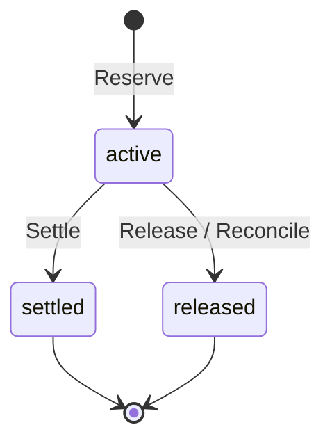
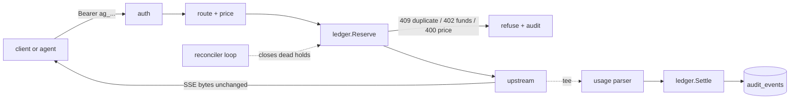
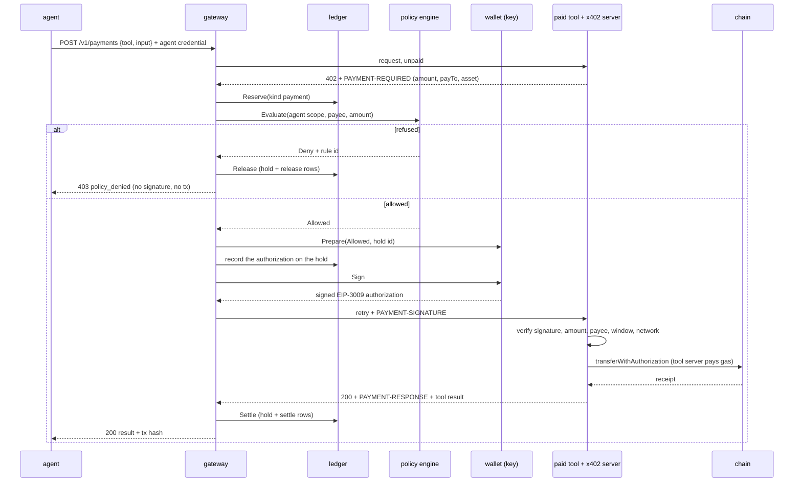
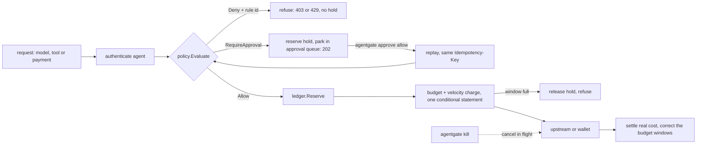

# AgentGate

A custody-grade gateway for AI agents: every model call and every payment is authorized, metered, limited and auditable.

## Status

Early work. Foundations, the Postgres ledger, the gateway (OpenAI-compatible and native Anthropic endpoints, streaming, audit, report), x402 payments on a simulated chain, and the policy engine (scoped agent credentials, budgets, velocity limits, an approval queue, a kill switch). The later layers land in further pull requests.

## Build and test

Requires Go and a reachable Postgres (17 recommended).

```bash
go build -o bin/agentgate ./cmd/agentgate
bin/agentgate version

createdb agentgate_test
export DATABASE_URL='postgres:///agentgate_test?host=/tmp'
gofmt -l . && go vet ./... && AG_REQUIRE_DB=1 go test -race -count=1 ./...
```

Without `DATABASE_URL`, database tests skip; with `AG_REQUIRE_DB=1` they fail instead. `agentgate migrate` applies the SQL files in `migrations/`.

Copy `.env.example` to `.env` for local secrets (gitignored) and `configs/agentgate.example.json` for config.

## Ledger

Money is `int64` Nanos (1e-9 USD). A request first **reserves** (holds) its worst-case cost with one conditional `UPDATE`, then **settles** the real cost or **releases** the hold. Retries with the same key replay the first result; a crashed process's hold is closed by `Reconcile` after it expires; an overage is charged only up to the free balance and the rest is flagged. `Audit` recomputes the invariants from the append-only `ledger_entries`.



Invariants I1-I7 and their tests are in [docs/learn/ledger.md](docs/learn/ledger.md). Single gateway process; the ledger itself is safe with several.

## Gateway

Two endpoints, one flow. `POST /v1/chat/completions` (OpenAI format) and `POST /v1/messages` (native Anthropic, what Claude Code speaks; `Authorization: Bearer` and `x-api-key` both work). A request is authenticated to an account, routed by model prefix to a provider, priced from the price table, and **reserved** against the account before any upstream call. The response streams back byte for byte while a parser reads usage from the same bytes; then the real cost is **settled** and one audit row is written.



- **Providers.** `openai-compatible` (OpenAI, OpenRouter) forwards the path as is; `anthropic` forwards Messages natively and also translates chat completions (tool calls and SSE included). Routes map a model prefix to a provider and an upstream model name: [configs/providers.example.json](configs/providers.example.json). Anthropic body fields and `anthropic-version` / `anthropic-beta` headers pass through unchanged, so prompt caching and thinking keep working.
- **Cost.** In order: the provider's reported `cost`, the price table applied to reported tokens (input, output, cache read, cache write priced separately), a token estimate flagged `cost_source=estimated`. Prices come from `agentgate prices sync` (OpenRouter's free `/models`) into `configs/prices.json`; [an example](configs/prices.example.json) shows the shape.
- **Failures.** A stream that dies, ends without its terminal event (`[DONE]` / `message_stop`), carries an in-band error, a client that disconnects, a 429 or a 500 never leave a hold active: usage received so far is charged, the rest released, and the audit status says what happened.
- **Report.** `agentgate report --since 24h --by model` shows spend, tokens, cache hit rate, estimated cache savings and the split by cost source.
- **Single process.** One gateway process is assumed (the ledger itself is safe with several).

```bash
agentgate account create --name me                         # prints the account id
agentgate account deposit --account ID --amount 5
agentgate key create --account ID                          # prints the secret once (an agent with the default scope)
AG_PROVIDERS=configs/providers.json AG_PRICES=configs/prices.json OPENROUTER_API_KEY=... agentgate serve
agentgate report --since 7d --by model
agentgate reconcile                                        # one-shot; `serve` also runs it every 30s
```

Offline demo (fake upstream, throwaway database, no network): `demo/phase1.sh`.

### Live smoke

On 2026-11-03, 8 requests went through OpenRouter on `anthropic/claude-haiku-5.5`, on both endpoints, stream and non-stream. A cache write (3392 tokens) followed by a cache read (3392 tokens) was parsed correctly, and the ledger charge matched OpenRouter's `/generation` `total_cost` on the 2 generations checked. This was a single small run, not dogfooding.

### Latency overhead

Measured offline: `go run ./bench` starts a fake upstream with a fixed 20 ms delay before the first byte and 2 ms between events, plus an in-process gateway on a throwaway Postgres database, and sends the same streaming request directly and through the gateway (Apple M3 Pro, loopback, local Postgres 17). These are **overhead numbers against a fake, not real-provider latency**; real-traffic numbers come from dogfooding.

| concurrency | path | requests | TTFB p50 | TTFB p99 | total p50 | total p99 |
|---|---|---|---|---|---|---|
| 1 | direct to fake | 300 | 22.61ms | 23.75ms | 35.41ms | 36.78ms |
| 1 | via gateway | 300 | 24.48ms | 26.37ms | 39.64ms | 42.16ms |
| 50 | direct to fake | 3000 | 22.3ms | 27.36ms | 33.74ms | 37.12ms |
| 50 | via gateway | 3000 | 20.95ms | 67.78ms | 32ms | 80.76ms |

At concurrency 1 the gateway adds about 2 ms (first byte) to 4 ms (total) at p50 and 3 to 5 ms at p99 (auth, claim, reserve, attach, settle, audit: about six short Postgres round trips). At 50 the p99 grows by roughly 40 ms from database commit contention; the p50 comparison there is inside timer noise (the direct path's 20 ms timer sleeps longer than 20 ms on macOS). TTFB is the first body byte, total is the end of the stream.

## Payments

An agent can pay for a paid tool call through the public [x402](https://github.com/coinbase/x402) flow (v2, `exact` scheme, EIP-3009 `transferWithAuthorization`), hand-written here with go-ethereum and no x402 SDK. The rule that matters is **screen before sign**: the wallet's only signing path takes a `policy.Allowed`, a value only package `policy` can construct, so a refused payment never reaches the key and never reaches the chain (I10). The EIP-3009 nonce is derived from the ledger hold id, so a retried payment cannot settle twice on chain (I11).



Run it offline, with a simulated EVM chain inside the paid-tool process:

```bash
demo/phase15.sh
```

It makes two payments: a $0.01 call that settles on the simulated chain and is charged in the ledger, and a $0.50 call that is over the agent's $0.30 budget and is refused before signing. It prints the ledger rows (hold, settle; hold, release) and the audit rows.

What this is and is not:

- The offline run uses a mock token with Circle USDC's EIP-3009 interface, so it proves the protocol logic, not Base Sepolia behaviour.
- A run on Base Sepolia (`demo/phase15.sh --network base-sepolia`, needing an RPC URL, a gas-funded facilitator key and a USDC-funded wallet from the environment) is built but **separate and not part of the offline demo or CI**. The USDC address used there is Circle's [documented](https://developers.circle.com/stablecoins/usdc-contract-addresses) Base Sepolia one.
- The wallet refuses to start for any chain id except 84532 and the local simulated chain. `agentgate wallet new` writes a testnet key to a gitignored `0600` file and prints only the address.
- After signing, the chain is the source of truth. The authorization is recorded on the ledger hold before it is signed. A definite refusal (verification failed, or the transaction reverted) releases the hold. Any other outcome (lost connection, tool 5xx, a ledger failure after the transfer) leaves the hold for the reconciler, which asks the token contract: used, so it settles the authorized amount; unused with the window still open, so it waits; unused with the window closed, so it releases. A failed tool call therefore returns money after about three minutes, not at once.
- Who may pay whom is part of the agent's scope: its tool and payee allowlists, its daily and per-task budgets, its velocity limit and approval threshold (see [Policy](#policy)). The payments config file only lists tools and the network (`demo/payments.example.json`).

## Policy

Custody for agents: an agent is not "an API key with a budget", it is a **scoped identity**. Each agent has one credential, one ledger account, and a scope that says what it may use and how fast it may spend. One pure function, `policy.Evaluate(Request, Snapshot) Decision`, sits in front of model calls, tool calls and payments and answers `Allow`, `Deny` or `RequireApproval` with a rule id. Every decision, allow included, is written to an append-only `policy_decisions` table.

| What a custodian does | What AgentGate does | Rule id |
|---|---|---|
| Opens an account for one named client | `agent create`: one agent, one credential (SHA-256 stored), one ledger account | |
| Writes down what the client may hold or touch | Scope allowlists: models, tools, payees (default deny; a trailing `*` is a prefix) | `scope_model`, `scope_tool`, `scope_payee` |
| Sets a daily limit | Daily budget per UTC day, one conditional `UPDATE`, so parallel requests cannot exceed it | `budget_daily` |
| Limits what a single job may cost | Per-task budget, keyed by the `X-AgentGate-Task` header | `budget_task` |
| Limits how fast money may leave | Velocity: spend in a sliding 60 s window, in Postgres | `velocity` |
| Asks a second person above a limit | Approval queue: over-threshold requests wait with their money held; `approve allow` releases them once | `approval_threshold` |
| Freezes an account in an emergency | Kill switch: next request refused, in-flight streams cancelled within a second, usage received is settled | `agent_killed` |
| Closes an account | `agent revoke`: permanent, refused at once | `agent_revoked` |
| Keeps a ledger of every decision | `policy_decisions` rows with the rule id, joined to `audit_events` by request id | |

The rule order is fixed, and the first rule that fires decides: kill/revoke, then scope, then budget, then velocity, then approval. A request that breaks two rules always reports the earlier one, so a dead credential learns nothing else about the policy, and a human is only asked about requests that are otherwise allowed.



```bash
agentgate agent create --account ID --name researcher --models 'claude-*' --tools echo \
    --payees 0x7099... --daily 5 --task 1 --velocity 0.5 --approval-over 0.25    # prints the secret once
agentgate agent list
agentgate approve list                      # requests waiting for a human
agentgate approve allow ID --by alice       # the agent replays the request once, same Idempotency-Key
agentgate approve deny ID                   # releases the hold
agentgate kill --agent researcher           # and --resume to undo; `agent revoke` is permanent
```

- **Budgets count spend, not guesses.** A request is counted at its worst-case estimate when it is admitted and corrected to the real cost when it settles or is released. The reconciler does the same for a hold whose process died, so a crash does not leak budget.
- **Approvals are exact.** An approval pins the request (kind, model or tool, payee, amount, network, task, body); replaying the same `Idempotency-Key` with anything different is refused (422), the replay runs once (a second is 409), and an unused approval expires (default 15 minutes) and releases its hold. An approval lifts the approval threshold only: a budget or scope that no longer fits still refuses it. The approver's name is recorded.
- **No self-approval.** There is no HTTP route that approves, changes an agent or kills one. The CLI needs direct database access, which an agent credential never has.
- **T2 API keys keep working.** A migration turns every existing key into an agent with the default scope (any model, any tool, no limits, no payees), so existing clients are unaffected and cannot pay until a payee is listed.
- **Single gateway process.** The kill switch registry and the velocity window are simple because there is one process; the CLI kills through the database and the gateway notices within 250 ms.

Offline demo (burn a budget, trip velocity, queue and approve a request, refuse an out-of-scope model, kill a stream mid-flight): `demo/phase2-policy.sh`. Study guide: [docs/learn/policy.md](docs/learn/policy.md).

## Security and threat model

The gateway's job is to keep a provider key and an account's money out of reach of the thing calling it: provider keys live only in the gateway's environment and are never logged, put in a span, or relayed (the client never sees upstream headers: only an allowlist is copied back); client credentials are 256-bit random secrets stored only as SHA-256; a request can spend only what its account holds, because the budget check is one atomic `UPDATE` in Postgres, not application code; prompts and responses are not stored unless an operator turns that on, and then bearer tokens and `sk-` patterns are redacted. It does not defend against a compromised gateway host (which holds the provider key and the database), a malicious operator, or secrets that appear in prompts in forms the redactor does not recognise (redaction is best effort, which is why storage is off by default). Per-agent scopes, budgets, approvals and a kill switch limit what a credential can do (see [Policy](#policy)). Single process, no TLS termination, no request rate limiting: put it behind a reverse proxy on a trusted network.

## Learn

- [Foundations](docs/learn/foundations.md)
- [Ledger](docs/learn/ledger.md)
- [Gateway](docs/learn/gateway.md)
- [Payments](docs/learn/payments.md)
- [Policy](docs/learn/policy.md)

## License

MIT
