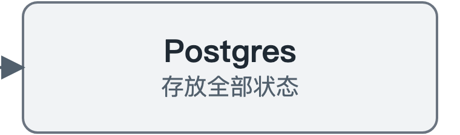
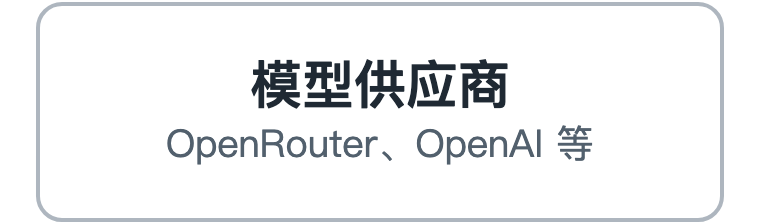
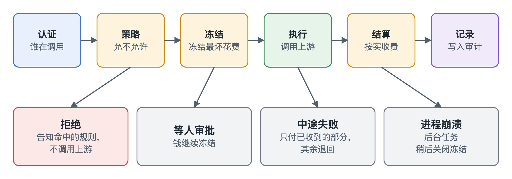

# AgentGate

[English](README.md) | 中文

> 中文版方便中文读者阅读，内容以英文版为准。

AgentGate 是一道架在 AI Agent 和所有花钱动作之间的闸门。模型调用、工具调用、付款，每一笔都要先授权、计量、限额，并留下记录。

能花钱的 Agent 也可能被工具返回的一段文字劫持，所以只给它一把带预算的 API 密钥是不够的。AgentGate 自己保管密钥，给每个 Agent 一个有权限范围的身份，每笔花费发生之前都先过账本和策略。

整个设计靠两条规则撑起来：

- **先冻结，再花钱。** 先按最坏情况冻结一笔钱，事后按真实花费结算，多余的退回。
- **先判定，再签名。** 策略拒绝的付款，根本碰不到钱包私钥。

## 整体架构

<p align="center">
<a href="docs/zh/sdk.md"></a><a href="docs/zh/policy.md"></a><br>
<br>
<a href="docs/zh/gateway.md"></a><a href="docs/zh/ledger.md"></a><br>
<br>
<a href="docs/zh/policy.md"></a><a href="docs/zh/ledger.md"></a><a href="docs/zh/runs.md"></a><br>
<br>
<a href="docs/zh/gateway.md"></a><a href="docs/zh/tools.md"></a><a href="docs/zh/payments.md"></a><br>
<br>
<a href="docs/zh/gateway.md"></a><a href="docs/zh/tools.md"></a><a href="docs/zh/payments.md"></a>
</p>

点击方框可以打开对应的文档。

## 它怎么工作

<p align="center"></p>

整个系统就是一个 Go 进程加一个 Postgres 数据库。运维人员用命令行或本地控制台直接写数据库，所以网关没有任何网络接口能让 Agent 批准自己的请求。

每个部分都有一篇短文，一两分钟就能读完：

| 部分 | 做什么 |
|---|---|
| [网关](docs/zh/gateway.md) | 站在 Agent 和模型供应商中间 |
| [账本](docs/zh/ledger.md) | 先冻结，再按真实花费收钱 |
| [策略](docs/zh/policy.md) | 规定每个 Agent 能做什么、能花多少 |
| [工具](docs/zh/tools.md) | 管工具权限，并筛查工具返回的内容 |
| [支付](docs/zh/payments.md) | 用 USDC 给工具付款，信区块链，不信工具 |
| [Run](docs/zh/runs.md) | 把一项工作的所有步骤串起来，方便查看或一起停止 |
| [控制台](docs/zh/console.md) | 本地网页：看 Agent、改限额、跑任务 |
| [Python SDK](docs/zh/sdk.md) | 给脚本和 Agent 用的轻量客户端 |
| [测试](docs/zh/testing.md) | 怎么做到不花钱也能测试 |

## 试一试

需要 Go 和一个运行中的 Postgres。这个演示用的是模拟模型供应商和临时数据库，不需要密钥，也不需要联网。

```bash
demo/phase1.sh
```

如果想在自己机器上一直开着网关和 console，按 `.env.example` 填好 `.env`，然后用一个脚本启动、停止或重启：

```bash
scripts/agentgate-local up
```

## 现状

| 已验证 | 怎么验证的 |
|---|---|
| 账本、网关、策略、工具网关、支付 | CI 测试，不需要任何密钥 |
| 本地链上的支付 | 本地 anvil 节点加 mock USDC，在 CI 中运行 |
| Base Sepolia 上的支付 | 一笔真实的测试网结算，见下 |
| OpenRouter | 线上测试刚开始，后续继续测 |

**还没做：** 真实流量试用。目前只支持测试网，并且只支持单个网关进程。详见[局限](docs/zh/limits.md)。

### 测试网结算

这里用的是没有真实价值的**测试网**代币，不是主网，也不是生产结算。

2026-11-06，网关在 Base Sepolia（chain id 84532）上为一次工具调用完成了付款：[结算交易](https://sepolia.basescan.org/tx/0x07682129c2aaa44875659058cd142457d9b065f411a39783c08ea04cacc96141)。工具收费 $0.01，策略批准，钱包签名，工具把签名提交上链兑现。复现方法见 `demo/phase15.sh` 开头的说明。

| 角色 | 地址 |
|---|---|
| USDC（Circle 测试币） | [`0x036C…CF7e`](https://sepolia.basescan.org/address/0x036CbD53842c5426634e7929541eC2318f3dCF7e) |
| 付款钱包 | [`0x9754…01E2`](https://sepolia.basescan.org/address/0x9754cA4033df6680B32a7f34a888Bec3E31c01E2) |
| 收款方 | [`0x7a88…75f7`](https://sepolia.basescan.org/address/0x7a889Db6Ebf3A876E6E2035017A2624814F475f7) |
| Gas 支付方 | [`0x85f5…f659`](https://sepolia.basescan.org/address/0x85f51b4dE84e47aA439b5C0aE79BDe437571f659) |

我们没有部署自己的合约，结算用的是 USDC 自带的签名转账功能。

## 许可证

MIT
