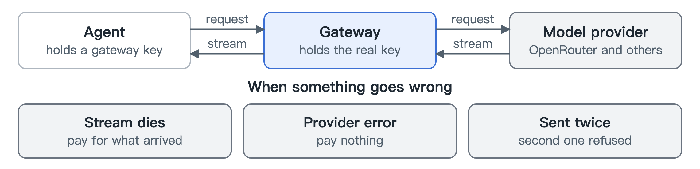

# Gateway

[中文](zh/gateway.md)

The gateway sits between your agents and the model providers. Agents call it the same way they call OpenAI or Anthropic, so most tools only need one URL changed. Claude Code works this way.

## The real key stays on the gateway

Each agent gets a key that is only good for talking to the gateway. The real provider key stays on the gateway. If a key leaks or an agent gets hijacked, you shut off that one agent and your provider account is untouched.

## Identity without a key

An agent can prove who it is with a short-lived SPIFFE certificate instead of a key. The gateway has an optional second port that requires mutual TLS and accepts only certificates from the listed trust domains: ours, and optionally those of customers who run their own SPIRE and federate with ours (`--spiffe-trust-domain ours,theirs`; their bundle comes from SPIRE, not from the gateway, and a listed domain without a bundle is refused). Foreign IDs map to agents the same way. The certificate's SPIFFE ID is mapped to one agent, for example with `agentgate agent set-spiffe`. A request on that port is that agent, and any key it also sends is ignored. The gateway keeps serving its plain port if SPIRE is down and opens the second port once a certificate is available. The console can give each research run its own short-lived certificate in place of the agent's key, and each request's span records which of the two proved the caller.

Keys stay as the fallback for clients that cannot get a certificate. You can turn the key off for an agent, so the certificate is its only way in. See [deploy/spire](../deploy/spire/README.md) for a single-VM setup.

## How a request flows

1. Work out who is calling.
2. Check whether it may make this request.
3. Set aside enough money to cover the worst case.
4. Call the provider and stream the answer back as it arrives.

## Who pays when something goes wrong

| What happened | Result |
|---|---|
| The stream dies halfway | You pay for what arrived |
| The provider returns an error | You pay nothing |
| The same request is sent twice | The second is turned away before it costs anything |

## Where prices come from

The provider's own figure comes first, then our price table, then an estimate that is clearly marked as one.

To start, copy [configs/prices.example.json](../configs/prices.example.json) (`--prices`) and [configs/providers.example.json](../configs/providers.example.json) (`--providers`). The listen address, database URL and hold limits can come from [configs/agentgate.example.json](../configs/agentgate.example.json) (`--config`); environment variables override it.

## Probes and logs

`/healthz` answers while the process runs; `/readyz` answers 200 only when the database replies within a second, else 503. Set `AG_LOG_FORMAT=json` (or `--log-format json`) for one JSON object per log line; the default is text.
