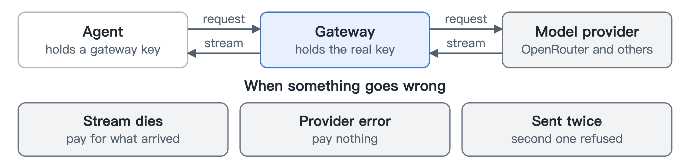

# Gateway

[中文](zh/gateway.md)

The gateway sits between your agents and the model providers. Agents call it the same way they call OpenAI or Anthropic, so most tools only need one URL changed. Claude Code works this way.

## The real key stays on the gateway

Each agent gets a key that is only good for talking to the gateway. The real provider key stays on the gateway. If a key leaks or an agent gets hijacked, you shut off that one agent and your provider account is untouched.

## How a request flows

1. Work out who is calling.
2. Check whether it may make this request.
3. Set aside enough money to cover the worst case.
4. Call the provider and stream the answer back as it arrives.

## Who pays when something goes wrong

| What happened | Result |
|---|---|
| The stream dies halfway | You pay for what arrived |
| The provider returns an error | You pay nothing |
| The same request is sent twice | The second is turned away before it costs anything |

## Where prices come from

The provider's own figure comes first, then our price table, then an estimate that is clearly marked as one.
