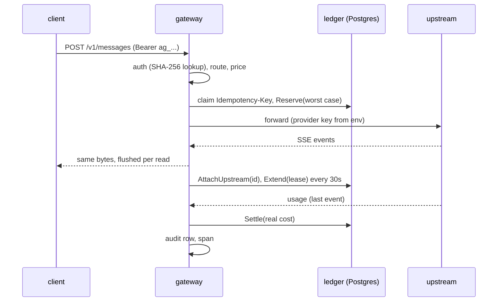

# Gateway

The gateway sits between a client and an LLM provider. For each call it checks who is asking, holds the worst-case cost in the [ledger](ledger.md), forwards the call, streams the answer back untouched, charges the real cost, and writes one audit row. Code: [internal/server](../../internal/server), [internal/provider](../../internal/provider), [internal/pricing](../../internal/pricing), [internal/audit](../../internal/audit).

## Model in one minute

Order of work in [`run`](../../internal/server/server.go) (line 180): authenticate, parse model, route, price (`unknown_model_price` is a 400), `policy` span (T4 fills it), [`reserve`](../../internal/server/server.go) (313), upstream, transfer ([`stream`](../../internal/server/server.go) 486 or [`unary`](../../internal/server/server.go) 452), [`settle`](../../internal/server/server.go) (590).

## Key flows

- **Hold size.** `bytes/3` of the request body as input tokens (priced at the dearer of input and cache-write) plus `max_tokens` (or the default) at the output price, capped at `max_hold_nanos`. High on purpose: an overage is only partly recoverable (I7).
- **Duplicates.** `ledger.Reserve` replays the first hold for a used key, so it cannot tell "retry" from "first call". The gateway first inserts a claim row in `gateway_requests`; the loser gets 409 `duplicate_request` carrying the winner's request id, and upstream is never called. If Reserve then fails (no funds), the claim is deleted so the same key can be retried after a top-up.
- **Streaming.** `stream` reads upstream in chunks, writes and flushes each chunk to the client, then hands the same bytes to a `provider.Parser` (a line-splitting `io.Writer`). Nothing is buffered beyond one read. The upstream id is attached as soon as the response headers arrive: `X-Generation-Id` (OpenRouter sends it on both surfaces; the Anthropic body id `msg_...` cannot be looked up) wins, the body id is the fallback.
- **Translation.** Chat completions routed to an `anthropic` provider go through `ChatToMessages`; the response is converted back by `MessagesToChat` or, for streams, `SSETranslator` one event at a time. Usage is parsed from the raw Anthropic bytes before translation.
- **Cost source.** Provider-reported `cost` wins; else price table on reported tokens; else a token estimate (`estimated`). OpenAI reports cached tokens inside `prompt_tokens`; the parser subtracts them so every class is priced once.
- **Lease.** A goroutine calls `Extend` every `HoldTTL/10` (30 s) while the upstream call runs. TTL is 5 minutes: nine missed ticks fit before expiry, and it is far longer than the lag before a finished call shows up in OpenRouter's `/generation`, so a "not found" at reconcile time means "no generation", not "not indexed yet".
- **Settle.** Key `settle:<hold id>`. `ErrHoldNotActive` means the reconciler already closed the hold: audit `settle_lost_to_reconciler` with the real usage, never retry.
- **Reconcile.** `agentgate reconcile` and a 30 s loop inside `serve` call `server.Reconcile`, which runs `Postgres.Reconcile` with `provider.GenerationLookup` (OpenRouter `GET /generation?id=`; a 400 means the id can never resolve, so it counts as not found) and writes one audit row per closed hold: `reconciled_settled` or `reconciled_unmetered`. The report shows how many holds and how much money were unmetered.
- **Failed streams.** `Parser.Failed()` is true for an in-band error or a missing terminal event; the audit status is `upstream_failed` and what arrived is charged.

## Invariants and the test that proves each

| | Meaning here | Test |
|---|---|---|
| I5 | parallel requests never overspend | `TestParallelBudget_I5` |
| I6 | a dead request's hold is settled from the provider's record; a live one is never reconciled | `TestReconcileUsesGenerationLookup_I6`, `TestLeaseExtendedWhileStreaming` |
| I7 | overage flagged on the audit row (`unrecovered_nanos`) | ledger `TestOverage_I7`; written in `settle` |
| I8 | partial usage charged, remainder released, `upstream_failed` | `TestMidStreamDeath_I8`, `TestFailuresLeaveNoActiveHold` |
| I9 | no key in logs, spans, client responses; hash-only credentials; bodies off by default and redacted | `TestSecretsNeverLeak_I9`, `TestKeyStoredAsHashOnly_I9`, `TestBodiesNotStoredByDefaultAndRedactedWhenOn` |
| flow 7 | duplicate key: 409, one upstream call | `TestDuplicateIdempotencyKey`, `TestDuplicateWhileInFlight` |
| flow 5 | stream bytes identical and incremental | `TestStreamPassthroughByteIdentical`, `TestStreamIsIncremental` |
| flow 6 | cost sources and cache pricing | `TestCachePricingBothFormats`, `TestProviderReportedCostWins`, `TestNoUsageFallsBackToEstimate` |

## Failure modes

- **Upstream 429/500.** Passed to the client with `Retry-After`; hold released; audit `upstream_error`; nothing charged.
- **Upstream dies mid-stream.** Bytes already sent stay sent; usage seen so far (or an estimate) is charged; audit `upstream_failed`.
- **Client disconnects.** The request context cancels the upstream call; settle and audit use a context detached from the client so they still run.
- **Gateway dies after Reserve.** Hold expires 5 minutes after the last extend; the reconciler settles from `/generation` or releases it unmetered.
- **Unary body unreadable.** The client gets 502 `upstream_failed`, never an empty 200.
- **Audit write fails.** Logged; the money path is not affected.

## Gotchas hit

- Detached contexts matter: using the request context for settle would skip the charge exactly when the client leaves.
- The fake upstream must abort the TCP connection (`panic(http.ErrAbortHandler)`), not just return, or the client sees a clean end of stream.
- `Content-Type` and `Retry-After` are copied back; everything else from the provider is dropped. An allowlist, so a new provider header cannot leak by default.
- Unknown JSON fields survive because the body is edited as `map[string]json.RawMessage`; when nothing changes the original bytes are forwarded.
- Provider keys come from `<NAME>_API_KEY`; config files have no key field.

## Quiz

Questions and answers

1. **Why a claim table when the ledger already has idempotency keys?** Reserve returns the original hold for a replayed key, so the gateway cannot tell a duplicate from a first call; the claim insert has exactly one winner.
2. **Why delete the claim when Reserve fails?** Nothing was held, so a retry with the same key after a top-up should work.
3. **Why is the hold size deliberately high?** Settling above the hold can only recover up to hold plus free balance (I7); a high hold makes that rare.
4. **How does the gateway keep the client from seeing upstream secrets?** It copies back only an allowlist of response headers and never forwards the client's own Authorization upstream.
5. **What happens if the client disconnects mid-stream?** The upstream request is cancelled, usage so far is settled using a detached context, and the audit status is `client_disconnected`.
6. **Why extend the lease every TTL/10?** So several missed ticks still leave the hold alive; the reconciler must never close a live request.
7. **Why TTL of five minutes?** Long enough that a finished call is indexed by `/generation` before the reconciler can ask; so "not found" really means no generation.
8. **What does `settle_lost_to_reconciler` mean?** The reconciler closed the hold first; the gateway records real usage, does not retry, and charges nothing.
9. **How are cached tokens priced for OpenAI format?** `prompt_tokens` includes them, so non-cached input = prompt - cached - cache write; each class has its own price.
10. **Why is the token estimate flagged?** So reports show how much of the spend is a guess, and so it can be compared with the provider bill.
11. **Why does `Parser` never return an error?** A parsing problem must not break the client's stream.
12. **Why is a plain hash lookup enough for credentials?** The secret has 256 random bits and only its hash is compared in the database; timing cannot lead an attacker toward a hash they cannot invert.

