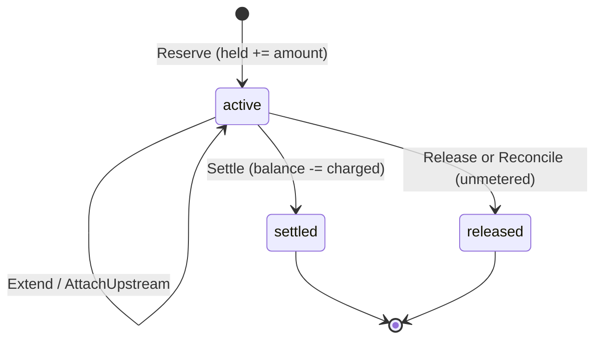

# Ledger

The credits ledger decides whether a model call, tool call or payment may start, and what it finally costs. Everything is in [postgres.go](../../internal/ledger/postgres.go); money is `int64` Nanos ([money.go](../../internal/money/money.go)), no floats.

## Model in one minute

Three tables ([0001_ledger.sql](../../migrations/0001_ledger.sql)):

- `accounts`: `balance_nanos`, `held_nanos`. Two CHECKs: `held >= 0` and `balance >= held` (I1).
- `holds`: money set aside for one in-flight request. `active` then `settled` or `released`, once.
- `ledger_entries`: append-only history (a trigger rejects UPDATE, DELETE, TRUNCATE). Every row records `balance_after` and `held_after`.

Entries per operation (the held and balance deltas Audit relies on):

| Call | Entries | balance | held |
|---|---|---|---|
| Deposit | `deposit` | +amount | 0 |
| Reserve | `hold` | 0 | +amount |
| Settle | `settle` (charged), then `release` (unspent rest, only if > 0) | -charged | -min(charged, hold), then -rest |
| Release | `release` | 0 | -amount |

## Key flows

- **Reserve** ([postgres.go:102](../../internal/ledger/postgres.go)). Insert the hold with `ON CONFLICT DO NOTHING` (a concurrent duplicate waits for the winner, then replays), then one conditional `UPDATE accounts SET held = held + $a WHERE status='active' AND balance - held >= $a`. No row back means insufficient funds (or inactive); the transaction rolls back and the hold insert vanishes.
- **Settle** ([postgres.go:320](../../internal/ledger/postgres.go)). `SELECT ... FOR UPDATE` the hold, then the account. `settleLocked` ([:256](../../internal/ledger/postgres.go)) applies I7: `charged = min(actual, hold + free balance)`, `unrecovered = actual - charged`.
- **Release** ([:358](../../internal/ledger/postgres.go)). Lock the hold, return its amount to free balance.
- **Reconcile** ([:410](../../internal/ledger/postgres.go)). List expired active holds, then one transaction per hold with `FOR UPDATE SKIP LOCKED`. Usage found via `UsageLookup` means settle; otherwise release with memo `reconciler: unmetered`. Keys are `reconcile:<hold id>`.
- **Audit** ([:484](../../internal/ledger/postgres.go)). One repeatable-read snapshot; recomputes balances and held from entries and checks them against the accounts and active holds.

Lock order is always hold, then account. Reserve and Deposit lock only the account. So nothing deadlocks.

## Invariants and the test that proves each

| | Meaning | Test |
|---|---|---|
| I1 | `0 <= held <= balance`, enforced by the DB | `TestSolvencyEnforcedByDB_I1`, `TestStateful_I1_I2` |
| I2 | balance = deposits - settled; held = active holds | `TestStateful_I1_I2`, `TestAuditDetectsDrift_I2` |
| I3 | one terminal state per hold | `TestSingleTerminalState_I3`, `TestReconcileRacingSettle_I3` |
| I4 | replays change nothing; same key, other params conflicts | `TestReplay_I3_I4`, `TestIdempotencyConflict_I4`, `TestConcurrentDuplicates_I4` |
| I5 | concurrent reserves never overbook | `TestConcurrentReserve_I5`, `TestConcurrentReserveProperty_I5` |
| I6 | a crashed process's hold is found and closed | `TestCrashRecovery_I6` (real subprocess, SIGKILL) |
| I7 | overage capped at hold + free balance, rest flagged | `TestOverage_I7` |

## Failure modes

- **Process dies after Reserve.** Hold stays active until `expires_at`; Reconcile closes it.
- **Client retries.** Same key replays the stored result. A different amount is `ErrIdempotencyConflict`.
- **Live settle vs reconciler.** Whoever locks the hold first wins. The loser sees a terminal hold: a live settle gets `ErrHoldNotActive`; the reconciler skips and counts nothing.
- **Reconciler crashes mid-pass.** Each hold is its own transaction, so finished holds stay finished.
- **Lookup error.** The hold stays active, `Report.Errors` counts it, the next pass retries.

## Gotchas hit

- The settle key's replay check must prove *this key* made the settlement (the `settle` entry points at this hold). Status alone would let any key "replay".
- A settle writes two entries under one key (`settle` and `release`). The unique index is `(account, key, kind)`, so that is legal.
- Original actual is recoverable on replay as `settled + unrecovered`, so no extra column was needed.
- Audit with several queries needs one snapshot, or concurrent writes cause false alarms.
- A shared test database across property-test iterations means the reconciler sees earlier iterations' holds; the test drains them.
- Entry ids order an account's history only because every mutation locks the account row before inserting entries.

## Quiz

Questions and answers

1. **Why is Reserve one UPDATE and not SELECT then UPDATE?** Two requests could read the same free balance and both pass. The `WHERE` clause evaluates under the row lock, so the second sees the first's hold.
2. **What stops an insolvent state if the Go code has a bug?** The CHECK constraints `held >= 0` and `balance >= held`.
3. **Two goroutines Reserve with the same key at once. What happens?** The second blocks on the unique index, the winner commits, the second's insert does nothing, and it returns the winner's hold.
4. **Settle replays with a different actual. Result?** `ErrIdempotencyConflict`; nothing is written.
5. **Settle actual exceeds hold and free balance is zero?** Charge the hold, record the rest in `unrecovered_nanos` and the memo; balance stays 0, not negative.
6. **Why `SKIP LOCKED` in Reconcile?** A live settle holding the row is skipped instead of making the reconciler wait or double-process.
7. **Why are Reconcile keys `reconcile:<hold id>`?** Two reconcilers (or a repeat pass) then produce the same entry key, so the unique index blocks a second outcome.
8. **A live Settle arrives after Reconcile released the hold?** `ErrHoldNotActive`, a distinct error so callers know the money was already returned.
9. **How does Audit know held is right?** It sums hold entries minus releases minus the held part of settles per account, and compares to both `accounts.held_nanos` and the sum of active holds.
10. **How does the crash test prove I6?** A separate process reserves and is SIGKILLed; the test advances `now`, runs Reconcile, and checks both the found-usage and not-found paths, then Audit.
11. **Why must lock order be hold then account?** Settle, Release and Reconcile all take it, so no two can wait on each other in a cycle.
12. **Why is `Extend` GREATEST(...)?** A late, shorter extend must not shorten the lease and expose a live request to the reconciler.

