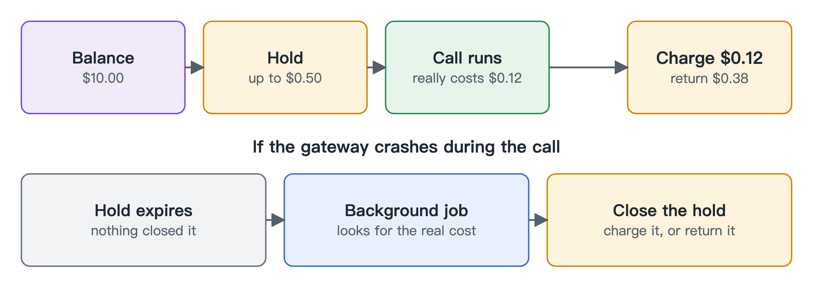

# Ledger

[中文](zh/ledger.md)

The ledger tracks the money. It works like a hotel deposit: hold an amount first, charge the real cost at checkout and let the rest go.

## Hold first, then charge the real cost

Before each call, we hold the most it could cost. Afterwards we charge what it really cost and give back the difference. If we hold $0.50 and the call costs $0.12, $0.38 goes back.

Calls that arrive together each have to claim their share first, so a group of agents can't overspend together.

## The books can always be recomputed

We don't keep a running total. We keep a history that can only be added to, so the balance can be worked out from scratch at any time. If the two disagree, something is wrong.

## When the gateway crashes

If the gateway dies mid-call, the held money gets stuck. A background job closes expired holds:

| Provider | What the job does |
|---|---|
| Lets you look up a past call, such as OpenRouter | Charges the real cost |
| Doesn't, such as OpenAI and Anthropic called directly | Charges the whole hold and marks it as not the real cost |

Without a lookup, the provider may well have billed us, and returning the money would leave that spend unpaid. So after a crash an account can pay up to its whole hold too much. We chose that on purpose: an overcharge can be refunded, but spend nobody paid for is lost. A call that fails cleanly is still returned in full.
