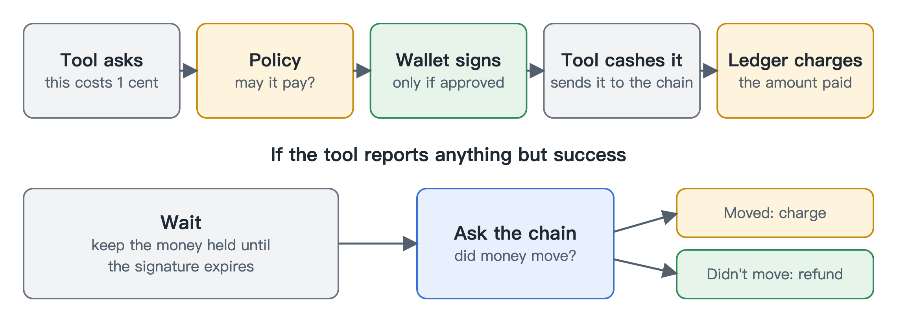

# Payments

[中文](zh/payments.md)

Sometimes a tool charges per use. It answers "that will be one cent" using x402, an open standard built on HTTP's old 402 Payment Required status. The gateway can pay it in USDC on the agent's behalf, so the agent doesn't need its own crypto setup.

The rule that matters most is that a payment has to pass policy before the wallet will sign it. This is built into the code's structure, not just a check someone remembered to add: the signing path can't run without proof of approval, and that proof works once, for one payment. The wallet also has its own spending cap per transaction, so a mistake in policy still can't drain it.

## Who decides whether the money moved

Payments have a nasty edge case. Once the wallet signs, the tool holds something it can cash. It might say "sorry, that failed" and cash it anyway a minute later, by accident or on purpose.

So after signing we stop believing what the tool says and only believe the blockchain. If the tool reports success, we charge. For anything else, the money stays held until the signature has expired, and then we check the chain. If the money moved, we charge. If it didn't, we refund.

The cost of this is that a failed payment takes a few minutes to come back. We accept that, because the alternative is refunding money that has already left.

## Good to know

This runs on testnets only. The wallet refuses to work on mainnet.

All agents share one wallet. Their budgets are separate, but the funds aren't. The balance in the ledger and the USDC in the wallet are also two different things, and a payment needs both.
