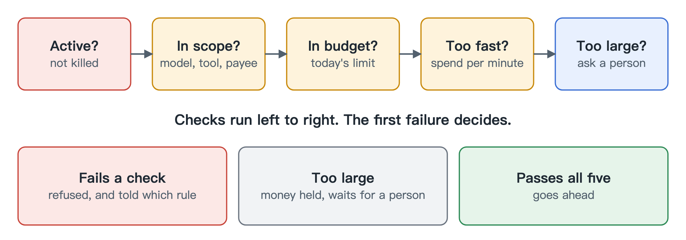

# Policy

[中文](zh/policy.md)

An API key with a budget treats an agent as a billing line. We treat it like a bank customer: it has an identity, it has limits, and someone can freeze the account.

## What you control

- which models and tools it may use, and who it may pay
- how much it may spend in a day
- how fast it may spend, which catches an agent stuck in a loop
- how large a single spend can be before a person must approve it

Anything you don't list is refused. An agent can't approve its own requests or switch off its limits, because that takes direct database access, which it never has.

## Rules run in order

The first rule that fails gives the answer. The agent is told which rule stopped it, so it can change course instead of retrying blindly. Yes and no decisions are both recorded.

## When a person must approve

The money stays held and the request waits for a decision. After a yes, the agent sends the same request again and it runs once. An approval covers only that request, can't be swapped for something else, and expires if nobody uses it.

## One command stops an agent

New requests are refused and running calls are cut off within about a second. You pay for what already happened.

## Keys expire and rotate

An API key can have an expiry date, set when the agent is created or changed later; by default it never expires. A key past its date is refused with the error `key_expired`. To replace a key without downtime, rotate it: the new key is shown once, and the old key keeps working for a grace period (24 hours unless you choose otherwise), but never past its own expiry. Only one old key is kept, so rotating again ends the earlier one. Turning the key off still refuses every key at once.

Before a key runs out, the gateway warns the operator. Once a key has less than seven days left, or a request uses an old key during its grace period, every response carries the header `X-AgentGate-Key-Expires` with the end time, and the gateway logs one warning per agent per hour. The key itself is never logged. `agentgate agent list` shows each agent's expiry.

## The same rules as Cedar policies

The rules also exist as [Cedar](https://www.cedarpolicy.com) policies kept in git, in `policies/cedar/`. `--cedar-policies` runs them beside the built-in rules on every decision, and each decision records both answers.

- **Shadow mode** (the default): the built-in rules decide and a Cedar failure never affects a request. Use it for a trial. `agentgate cedar shadow` shows how often the two agree.
- **Enforce mode** (`--cedar-enforce`, or `AG_CEDAR_ENFORCE=true`): Cedar decides, for every decision, including the kill and scope checks and the tool list. The built-in rules still run and their answer is recorded beside Cedar's, so `agentgate cedar shadow` keeps measuring agreement. If Cedar fails, the request is denied with the rule `cedar_error`; the gateway never falls back to the built-in rules. A payment that Cedar allows but the built-in rules do not is refused with `cedar_no_proof`, because only the built-in rules can issue the approval a signature needs.

`--cedar-enforce` without `--cedar-policies` stops the gateway at startup. To go back to shadow mode, remove `AG_CEDAR_ENFORCE` and restart.

## Where the limits are soft

- **Task budgets rely on the client.** The client names the task, so a hostile agent can invent a new one for each call.
- **Budget checks use an estimate.** If our price table is out of date or a request is very large, one call can occasionally land over budget. The account balance is the real ceiling.
