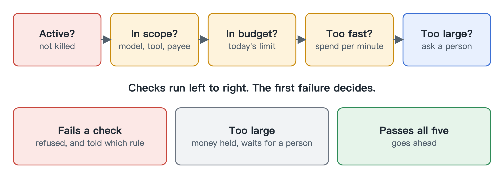

# Policy

An API key with a budget treats an agent as a billing line. We treat it more like a bank customer: it has an identity, it has limits, and someone can freeze the account.

For each agent you decide:

- which models and tools it may use, and who it may pay
- how much it may spend in a day
- how fast it may spend, which catches an agent stuck in a loop
- how large a single spend can be before a person has to approve it

Anything you don't list is refused. An agent with no list of payees can't pay anyone.

Every request is checked against these rules in the same order, and the first rule that fails gives the answer. The agent is told which rule stopped it, so it can change course instead of retrying blindly. Every decision is recorded, including the ones that said yes.

When a request needs approval, the money stays held and the request waits. A person looks at it and says yes or no. If the answer is yes, the agent sends the same request again and it runs once. An approval covers that exact request, so the agent can't swap in something else, and it expires if nobody uses it.

If an agent goes wrong, one command stops it. New requests are refused and anything it has running is cut off within about a second. You pay for what already happened.

Agents can't approve their own requests or switch their limits off, because those actions don't exist on the network. They need direct access to the database, and an agent never has that.

## Where the limits are soft

The per-task budget relies on the client being honest, since the client names the task. A hostile agent can invent a new task for each call.

Budgets are checked against an estimate. If a request sets no limit on its output, it can cost more than we estimated, and one call can push an agent past its daily budget. The account balance is still a real ceiling.
