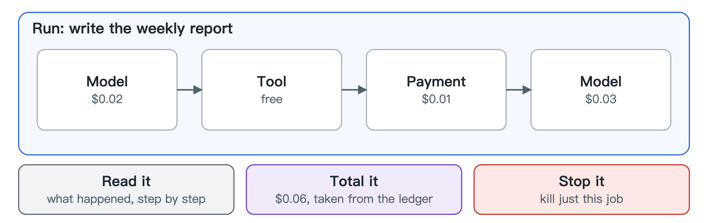

# Runs

[中文](zh/runs.md)

To finish one job, an agent makes dozens of calls, mixing models, tools and payments. A run ties them together.

## See what a job did

Open a run to see what the agent did, in what order, what each step cost and how it ended. That's usually the fastest way to answer "why did this cost so much?" or "what did it do before it went wrong?".

The cost shown comes straight from the ledger, so it can't disagree with the books.

## Stop just this job

If a job goes off the rails, you can stop its whole run and leave the agent's other work alone.

## Run research under its own user

On a single machine, a research run can start as its own unix user (`--runner-user`), with its own SPIFFE certificate that the runner fetches itself. Then the runner's identity is issued to that user alone, and a compromised run cannot read the gateway's files or keys. Stopping a run still works: the console marks it killed in the gateway, which refuses all its further requests, and stops the runner's systemd unit. Setup and roll back are in [deploy/runner-user.md](../deploy/runner-user.md).
