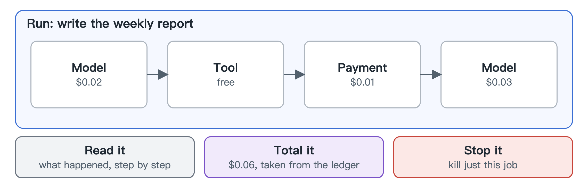

# Runs

Agents don't make one call. They make dozens, mixing model calls, tool calls and payments to finish one job. A run ties those together.

You can open a run and read it like a story: what the agent did, in what order, what each step cost and how it ended. That's usually the fastest way to answer "why did this cost so much?" or "what did it do before it went wrong?".

A run can also be stopped as a unit. If one job has gone off the rails, you can kill that job and leave the agent's other work alone.

The cost shown for a run comes straight from the ledger, so it can't disagree with the books.
