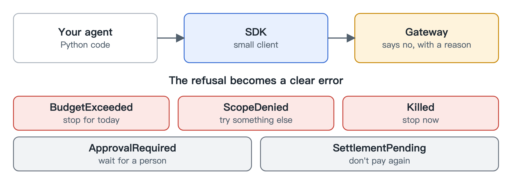

# Python SDK

You don't need an SDK, since the gateway speaks standard formats. The Python client is a small convenience for scripts and agents that want the extras: running several calls as one job, paying for tools, and checking how much budget is left.

Its most useful feature is the errors. When the gateway refuses something, you get a specific error such as "over budget", "outside your scope" or "this agent was killed". Your code can respond sensibly, instead of treating every refusal as a failure worth retrying.

Two responses need care because neither one means success. One says a person has to approve this first. The other says a payment may have gone through and we're waiting for the chain to confirm. In that second case, don't retry it as a new payment.
