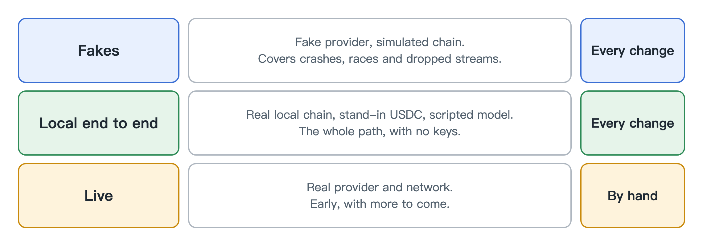

# Testing

[中文](zh/testing.md)

Testing something that spends money has an obvious problem: you don't want to spend money. So almost everything here runs with no keys, no faucet and nothing leaving the machine.

There are three levels.

**Fakes.** A fake model provider and a simulated blockchain inside the test. These are fast and cover the logic, including the unpleasant cases such as crashes, dropped streams and two requests racing each other.

**Local end to end.** A real local blockchain node with a stand-in USDC, plus a scripted model server that answers over real HTTP. The gateway doesn't know the difference and has no special test mode. This shows the whole path works, from request to on-chain receipt and back into the books. CI runs this on every change.

**Live.** Real providers and real networks. This is the thin part so far: one small run against OpenRouter, and nothing yet on a public testnet.

We also keep a set of scripted scenarios with an expected verdict for each one, such as "this should be refused for being over budget". They include plenty of requests that should be allowed, because a gateway that refuses everything would otherwise look perfect.

Be careful how you read a clean score. We wrote the scenarios alongside the rules, so passing shows the rules do what we meant. It says nothing about how they would hold up against an attacker who has never seen them. Local tests prove our accounting, not how a real provider or Circle's real USDC behaves.
