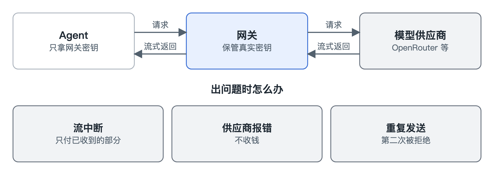

# 网关

[English](../gateway.md)

网关站在你的 Agent 和模型供应商中间。Agent 跟它说话的方式，和跟 OpenAI、Anthropic 说话一样，所以大多数工具只要改一个地址就能用上，Claude Code 就是这样接入的。

真正的供应商密钥留在网关上。每个 Agent 拿到的是自己的一把钥匙，这把钥匙只能用来访问网关。就算 Agent 泄露了密钥或者被劫持，你只要停掉这一个 Agent，供应商账号不受影响。

请求进来后，网关先确认是谁在调用，再检查这个调用者能不能发这个请求，然后留出足够覆盖最坏情况的钱，最后才去调用供应商。结果一边生成一边流回 Agent，所以网关增加的延迟很小，用量数据也是在流经过时顺手读出来的。

长时间的流式调用经常出问题，所以大部分心思都花在这里。流中途断了，只付已经收到的部分。供应商报错，不用付钱。同一个请求不小心发了两次，第二次在花钱之前就被挡回去。

价格取能拿到的最可靠来源：优先用供应商自己给的数字，没有就用我们的价格表，再没有就用估算值，并且明确标记为估算。
