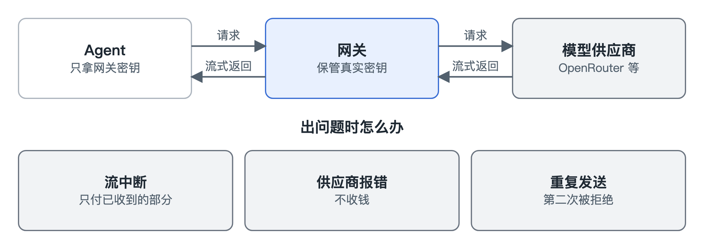

# 网关

[English](../gateway.md)

网关站在 Agent 和模型供应商中间。Agent 调用它的方式和调用 OpenAI、Anthropic 一样，大多数工具只要改一个地址，Claude Code 就是这样接入的。

## 密钥留在网关

每个 Agent 只拿一把访问网关的钥匙，真正的供应商密钥留在网关上。钥匙泄露或 Agent 被劫持时，停掉这个 Agent 就行，供应商账号不受影响。

## 不用密钥的身份

Agent 可以用短期的 SPIFFE 证书证明身份，不必再带密钥。网关有一个可选的第二个端口，要求双向 TLS，只接受同一个信任域签发的证书。证书里的 SPIFFE ID 对应一个 Agent，例如用 `agentgate agent set-spiffe` 绑定。走这个端口的请求就是那个 Agent，请求里即使带了密钥也会被忽略。SPIRE 不可用时，网关照常提供普通端口的服务，等证书可用后再打开第二个端口。控制台可以为每次研究任务单独申请一张短期证书，代替 Agent 的密钥；每个请求的 span 会记录是证书还是密钥证明了调用方的身份。

密钥仍然保留，给拿不到证书的客户端兜底。你可以给某个 Agent 关掉密钥，让证书成为它唯一的入口。单机部署见 [deploy/spire](../../deploy/spire/README.md)。

## 一个请求怎么走

1. 确认是谁在调用。
2. 检查它能不能发这个请求。
3. 留出足够覆盖最坏情况的钱。
4. 调用供应商，结果边生成边流回 Agent。

## 出问题时怎么算钱

| 情况 | 结果 |
|---|---|
| 流中途断了 | 只付已经收到的部分 |
| 供应商报错 | 不用付钱 |
| 同一个请求发了两次 | 第二次在花钱前被挡回去 |

## 价格从哪里来

优先用供应商给的数字，其次用我们的价格表，最后才用估算值，并明确标记为估算。
