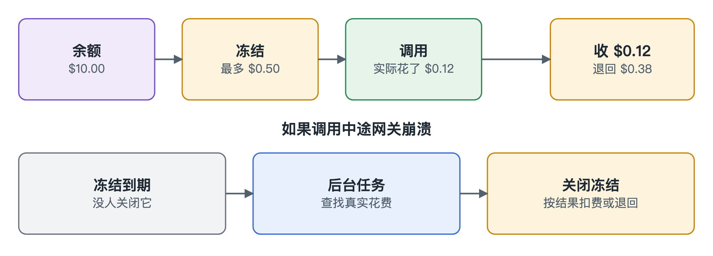

# 账本

[English](../ledger.md)

账本负责记钱，工作方式很像酒店押金：先冻结一笔，退房时按真实金额收费，其余解冻。

## 先冻结，再按实收费

每次调用前，先冻结最多可能花的钱；结束后按真实花费收钱，差额退回。比如冻结 $0.50，实际花了 $0.12，就退回 $0.38。

同时进来的调用都得先占下自己那份，所以一群 Agent 没法一起超支。

## 账目随时可以重算

我们记的不是一个累计数，而是一份只能追加的历史，随时可以从头算出余额。两边对不上，就说明出了问题。

## 网关崩溃时怎么办

网关中途挂掉时，冻结的钱会卡住。后台任务会关掉过期的冻结：

| 供应商 | 怎么处理 |
|---|---|
| 能事后查询，比如 OpenRouter | 按真实花费收钱 |
| 查不到，比如直连 OpenAI 和 Anthropic | 收下全部冻结金额，并标记这不是真实花费 |

查不到时，供应商很可能已经收了钱，退回去就没人买单。所以崩溃时账户最多多付整笔冻结金额。这是有意的选择：多收的还能退，没人买单的钱就真的没了。正常失败的调用仍然全额退回。
