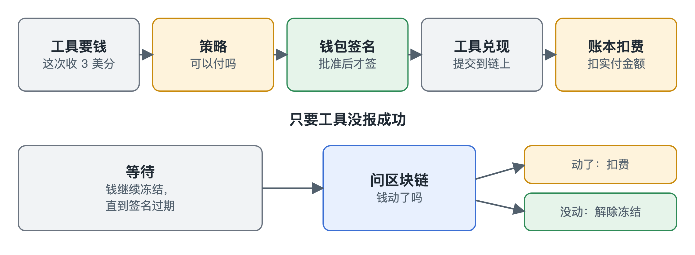

# 支付

[English](../payments.md)

有些工具按次收费，通常每次几美分。网关可以替 Agent 付款，Agent 不需要任何加密货币配置。普通工具不受影响，只有专门做了收费功能的工具才会参与。

## 先了解几个概念

- **USDC：** 一种数字美元，1 USDC 约等于 1 美元。
- **区块链：** 记录谁持有多少钱的公开账本，任何人都能查。
- **钱包：** 保管授权花钱的私钥。我们的钱包在网关里，Agent 碰不到。
- **x402：** 网络收费的开放标准。工具用 HTTP 402 状态码报价，调用方带上付款凭证再请求一次。

USDC 还支持用签名付款。钱包不亲自转账，而是签一张“付给这个工具三美分”的凭证，就像开支票。工具把它拿到区块链上兑现，手续费由工具方承担。

## 一笔付款怎么走

1. 网关调用工具，工具回复 402 和价格。
2. 网关在账本里冻结这笔钱。
3. 策略做判定。不通过就解除冻结，什么都不签。
4. 钱包签名，网关带上签名重发请求。
5. 工具验证签名并兑现，USDC 转给工具。
6. 工具返回结果，账本把冻结转成扣费。

## 策略通过，钱包才签名

这写进了代码结构：没有批准凭证，签名这条路就走不通，而且一张凭证只对应一笔付款。钱包还有单笔上限，所以就算策略出错，也掏不空它。

## 钱动没动，区块链说了算

钱包签名后，工具在签名过期前都能兑现。它可能先说失败，一分钟后又兑现，所以工具报失败不能算数。

| 工具的回复 | 我们怎么做 |
|---|---|
| 成功 | 收钱 |
| 其他任何情况 | 冻结保留到签名过期，再查区块链：钱动了就收钱，没动就解除冻结 |

收钱和解除冻结都只是账本记录，区块链上不用转回任何东西。工具谎称收到钱对它没有好处，万一发生，对账报表也能查出来。

代价是付款失败后，钱要过几分钟才回来。我们接受这一点，因为另一种做法是把已经离开的钱再退一次。

## LiteScraper：演示用的卖家

我们的钱包只能用在测试网，而真实的收费工具收真钱。所以仓库自带一个付费搜索工具 LiteScraper 来扮演卖家。

它向 Agent 收测试币，钱进我们自己的地址，再用普通 API key 去 Firecrawl 搜索。结果是真的，但 Firecrawl 看不到付款和签名。

这能证明付款流程在公共网络上走得通，但不能证明它和我们控制不了的卖家对接过。

## 需要知道的

- 目前只能在测试网运行，钱包会拒绝主网。
- Agent 的余额是账本里的数字，钱包里的 USDC 才是钱本身，一笔付款两边都要够。
- 所有 Agent 共用一个钱包：预算分开，资金不分开。
