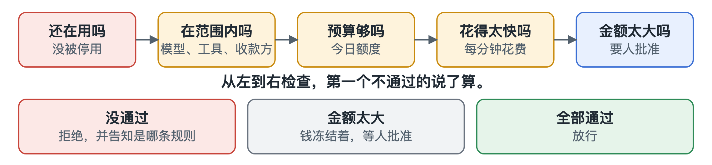

# 策略

[English](../policy.md)

带预算的 API 密钥只是把 Agent 当成一条账单。我们更愿意把它当成银行客户：有身份，有额度，出事时可以冻结账户。

你可以给每个 Agent 规定：

- 能用哪些模型和工具，能付钱给谁
- 一天最多花多少
- 花钱的速度上限，用来抓住陷入死循环的 Agent
- 单笔超过多少要人批准

没写进去的一律拒绝。一个 Agent 如果没有收款方名单，就谁也付不了。

每个请求都按同样的顺序过这些规则，第一条不通过的规则决定结果。Agent 会被告知是哪条规则拦住了它，这样它可以换个做法，而不是盲目重试。每次判定都有记录，放行的也一样。

如果请求需要审批，钱继续冻结，请求排队等着。有人看过之后决定批准或拒绝。批准后，Agent 重新发送同一个请求，它只会执行一次。一次批准只对应那个具体的请求，Agent 没法趁机换成别的内容，没人用的话也会过期。

Agent 出了问题，一条命令就能停掉。新请求全部拒绝，正在跑的调用大约一秒内切断。已经发生的部分照常付钱。

Agent 批准不了自己的请求，也关不掉自己的限制，因为网络上根本没有这些操作。做这些事需要直接访问数据库，而 Agent 永远没有这个权限。

## 哪些限制没那么硬

任务预算靠客户端老实配合，因为任务名是客户端自己起的。恶意 Agent 可以每次调用都编一个新任务。

预算是在请求开始前按估算值检查的。我们给每个请求都设了输出上限，保证估算站得住，但供应商还是可能收得比预期多，比如我们的价格表过时了。特别大的请求也只会冻结一个固定上限，而不是完整的最坏情况。所以偶尔会有一次调用超出预算。账户余额才是真正的天花板。
