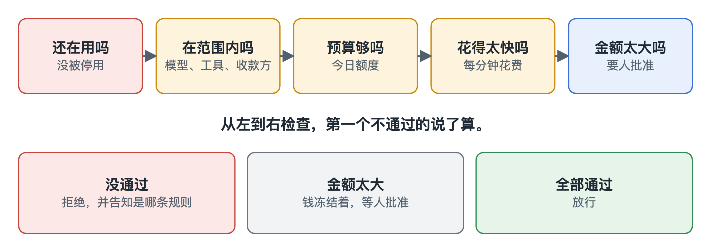

# 策略

[English](../policy.md)

带预算的 API 密钥只把 Agent 当成一条账单。我们把它当成银行客户：有身份，有额度，出事时可以冻结账户。

## 能管什么

- 能用哪些模型和工具，能付钱给谁
- 一天最多花多少
- 花钱的速度上限，用来抓住陷入死循环的 Agent
- 单笔超过多少要人批准

没写进去的一律拒绝。Agent 批准不了自己的请求，也关不掉自己的限制，因为这些操作需要直接访问数据库，而它没有这个权限。

## 规则按顺序检查

第一条不通过的规则决定结果。Agent 会被告知是哪条规则拦住了它，这样可以换个做法，不用盲目重试。放行和拒绝都有记录。

## 需要人批准时

钱继续冻结，请求排队等人决定。批准后 Agent 重发同一个请求，只会执行一次。批准只对这个请求有效，内容不能换，没人用也会过期。

## 一条命令停掉 Agent

新请求全部拒绝，正在跑的调用约一秒内切断。已经发生的部分照常付钱。

## 密钥会过期，也能轮换

API 密钥可以设置过期时间，创建 Agent 时设，之后也能改；默认永不过期。过期的密钥会被拒绝，错误码是 `key_expired`。想不停机地换密钥，就做轮换：新密钥只显示一次，旧密钥在宽限期内继续可用（默认 24 小时，可自行指定），但不会超过它自己的过期时间。只保留一把旧密钥，所以再轮换一次，上一把旧密钥就失效了。把密钥关掉，则所有密钥立刻都被拒绝。

密钥到期前，网关会提醒运维。密钥剩余不到七天，或者请求用的是宽限期内的旧密钥时，每个响应都会带上 `X-AgentGate-Key-Expires` 头，值是到期时间，网关对每个 Agent 每小时记一条警告。密钥本身不会写进日志。`agentgate agent list` 会显示每个 Agent 的到期情况。

## 同样的规则，写成 Cedar 策略

这些规则也以 [Cedar](https://www.cedarpolicy.com) 策略的形式存在 git 里（`policies/cedar/`）。用 `--cedar-policies` 打开影子模式后，每次决策两套都会跑，并记录两者是否一致。对 Agent 没有任何影响：做决定的仍是内置规则，Cedar 出错也不会影响请求。`agentgate cedar shadow` 可以查看记录。计划是：记录显示没有分歧之后，才让 Cedar 来执行。

## 哪些限制没那么硬

- **任务预算靠客户端配合。** 任务名是客户端自己起的，恶意 Agent 可以每次编一个新任务。
- **预算检查用的是估算值。** 价格表过时或请求特别大时，偶尔会有一次调用超出预算。账户余额才是真正的天花板。
