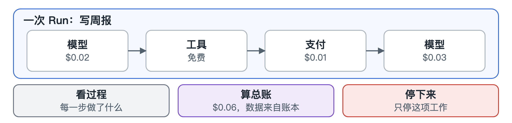

# Run

[English](../runs.md)

为了完成一项工作，Agent 会发出几十次调用，模型、工具、付款混在一起。Run 把这些串起来。

## 看清一项工作做了什么

打开一个 Run，就能看到 Agent 做了什么、先后顺序如何、每一步花了多少、结果怎样。想知道“这次怎么这么贵”或者“出事之前它干了什么”，这通常是最快的办法。

Run 显示的花费直接来自账本，所以不会和账目对不上。

## 只停这一项工作

某项工作跑偏时，可以把这个 Run 整个停掉，不影响这个 Agent 的其他工作。

## 让研究任务以独立用户运行

在单台机器上，研究任务可以用独立的 unix 用户启动（`--runner-user`），并由 runner 自己获取 SPIFFE 证书。这样 runner 的身份只会发给这个用户，即使某次运行被攻破，也读不到网关的文件和密钥。停止任务仍然有效：控制台先在网关里把这个 Run 标记为已停止，网关此后拒绝它的全部请求，同时停止 runner 的 systemd 单元。设置和回滚步骤见 [deploy/runner-user.md](../../deploy/runner-user.md)。
