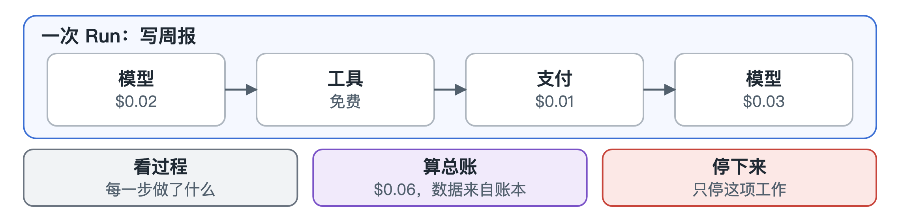

# Run

[English](../runs.md)

Agent 不会只调用一次。为了完成一项工作，它会发出几十次调用，模型、工具、付款混在一起。Run 就是把这些串起来。

打开一个 Run，就像读一个故事：Agent 做了什么、先后顺序如何、每一步花了多少、结果怎样。想知道“这次怎么这么贵”或者“出事之前它干了什么”，这通常是最快的办法。

Run 也可以整个停掉。如果某项工作跑偏了，你可以只杀掉这一项，不影响这个 Agent 的其他工作。

Run 显示的花费直接来自账本，所以不可能和账目对不上。
