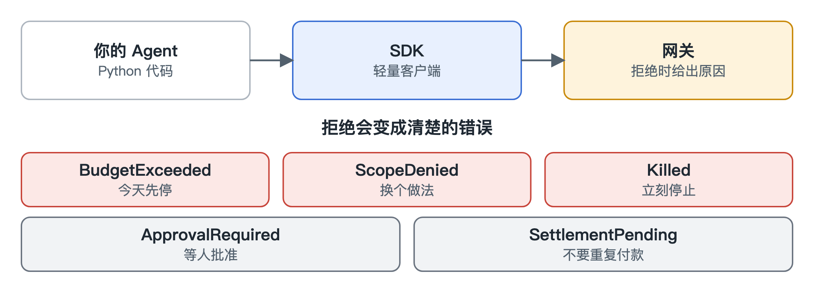

# Python SDK

[English](../sdk.md)

不用 SDK 也完全可以，网关说的都是标准格式。Python 客户端只是给脚本和 Agent 的一点便利，方便它们把多个调用归到同一项工作、给工具付款、查询还剩多少预算。

它最有用的地方是错误处理。网关拒绝时，你会得到一个具体的错误，比如“超预算”“超出权限范围”“这个 Agent 已被停止”。这样你的代码可以合理应对，不用把每次拒绝都当成值得重试的失败。

有两种返回要特别注意，它们都不代表成功。一种是说这件事要先等人批准。另一种是说付款可能已经完成，正在等区块链确认。遇到第二种，千万不要当成新付款重试。
