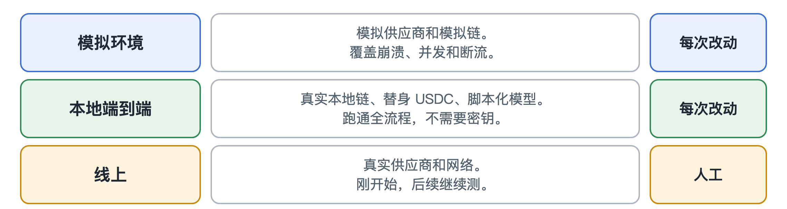

# 测试

[English](../testing.md)

测试一个会花钱的系统，你并不想真的花钱。所以几乎所有测试都不需要密钥和测试币，也没有数据离开本机。

## 测试分三层

### 模拟环境

模拟的模型供应商和区块链。速度快，能覆盖崩溃、断流、两个请求抢跑这些麻烦情况。

### 本地端到端

真实的本地区块链节点，配替身 USDC，再加一个通过真实 HTTP 应答的脚本化模型服务。网关分不出区别，也没有专门的测试模式。这一层证明整条路是通的，CI 在每次改动时都会跑。

LiteScraper 可以录下真实结果再回放，这样在本地测试真实 Agent 时不耗搜索额度，也不会被限流。

### 线上

真实的供应商和网络。这是目前最薄弱的一层：对 OpenRouter 的测试才刚开始，公开测试网上的结算规模也还很小，后续会继续测。

## 脚本化场景

每个场景都写好了预期结果，比如“这个请求应该因为超预算被拒绝”。里面有不少本该放行的请求，否则一个什么都拒绝的网关看起来也是满分。

## 全部通过说明不了什么

场景和规则是一起写的，通过只说明规则按我们的本意工作，说明不了它们面对陌生攻击者能撑多久。本地测试证明的是我们的账算得对，不代表真实供应商或 Circle 真实 USDC 的行为。
